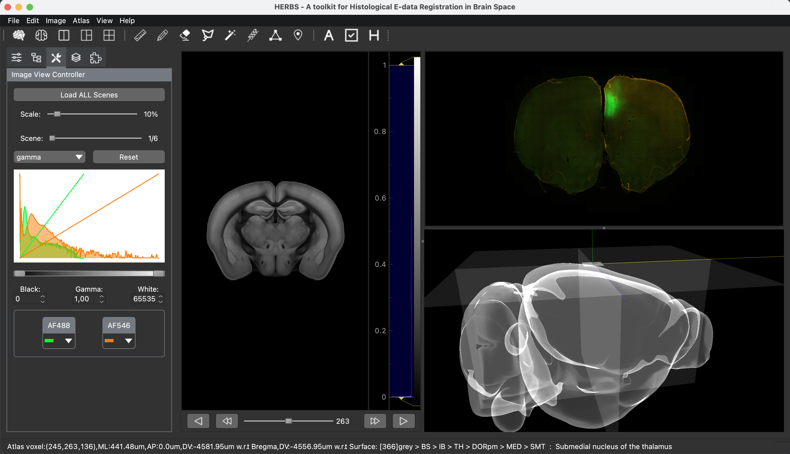

# DriftlessMap and its HERBS legacy

DriftlessMap grew out of HERBS (Histological E-data Registration in rodent
Brain Spaces). HERBS is now a legacy project: DriftlessMap 2.0 has its own
interface, registration assistants, file formats, persistence, probe and
implant reconstruction, and test suite. This note is the one place that
records the connection, credits the HERBS developers, and lists what is kept
for compatibility with HERBS data.

- Original project: <https://github.com/Whitlock-Group/HERBS>
- Original license: MIT
- Recorded upstream base commit: `7a181097a57d9f34b189f233a484a0f0c228c5da`
- DriftlessMap: <https://github.com/mohebi-n-associates/DriftlessMap>

DriftlessMap is not affiliated with or endorsed by the original HERBS
developers or the Whitlock Group.

## Acknowledgement of the HERBS developers

HERBS was created by Jingyi Guo Fuglstad, Pearl Saldanha, Jacopo Paglia and
Jonathan R. Whitlock, with further code, testing, documentation and research
contributions recorded in the inherited Git history and in `THANKS.txt`.
DriftlessMap gratefully acknowledges their work. HERBS was described in:

Fuglstad JG, Saldanha P, Paglia J, Whitlock JR. Histological E-data
Registration in rodent Brain Spaces. *eLife*. 2023;12:e83496.
<https://doi.org/10.7554/eLife.83496> (RRID:SCR_022776)

DriftlessMap is developed by [Mohebi & Associates](https://www.mohebi-associates.org/),
[Ali Mohebi](https://www.mohebial.com/) and Esther Lara Gonzalez; see
`CONTRIBUTORS.md`. The Git history is preserved, so individual contributions
from both projects remain auditable.

## Licensing

DriftlessMap is licensed under the MIT License. Because it derives from HERBS
code, the license's conditions require keeping the original notice:

- The original `Copyright (c) 2022 HERBS Developers` notice is preserved
  verbatim in `LICENSE.txt`.
- `Copyright (c) 2026 Ali Mohebi and DriftlessMap contributors` covers
  subsequent modifications.
- Neither the project name nor this note changes the license governing the
  original HERBS code.

When redistributing DriftlessMap or a substantial portion of its source, retain
`LICENSE.txt`.

## Compatibility with HERBS data

DriftlessMap keeps reading HERBS work so existing research data is not stranded:

- Legacy `.herbs`, `.herbslayer`, `.herbsobj`, `.herbsslice` and `.herbstri`
  files open through a restricted reader. New files use `.dmap`, `.dmaplayer`,
  `.dmapobj`, `.dmapslice` and `.dmaptri`; HERBS cannot open them.
- `HERBS_CONFIG_DIR` and an existing HERBS settings file are still honoured;
  new configurations use `DRIFTLESSMAP_CONFIG_DIR`.
- Some persisted coordinate field names (for example `herbs_vox`) keep the
  HERBS name because renaming them would break existing datasets and analysis
  scripts.
- DriftlessMap installs only the `driftlessmap` package and command, never a
  `herbs` package or command, so both can live in one environment.

These names are kept for data compatibility only and do not indicate
affiliation with or endorsement by the HERBS developers.

## Legacy HERBS material

The [HERBS-era tutorials](Tutorial/README.md#herbs-tutorials) describe the
classic interface, which DriftlessMap still opens with `driftlessmap --classic`.
The HERBS CookBook was removed in 2.0.0; it remains in this repository's Git
history. The HERBS main window, the starting point of
DriftlessMap's classic interface:

## Adapted third-party code

- `driftlessmap/movable_points.py` adapts the `CustomGraphItem` example from
  pyqtgraph (<https://github.com/pyqtgraph/pyqtgraph>), MIT License,
  Copyright (c) 2012 University of North Carolina at Chapel Hill, Luke
  Campagnola.
