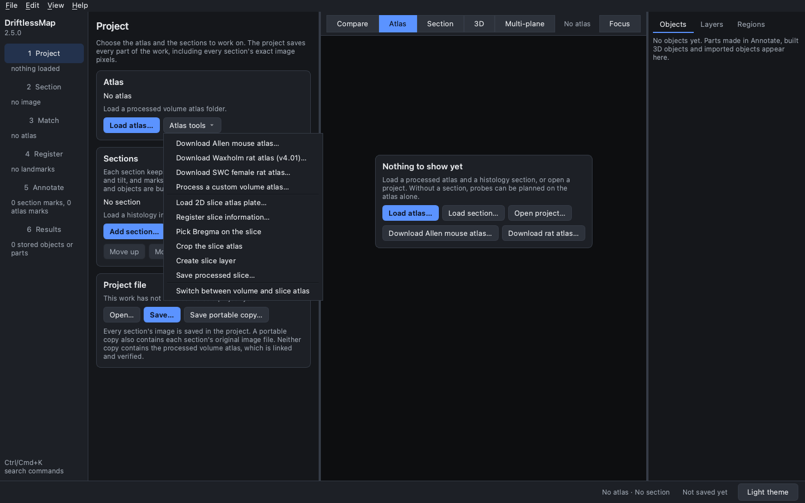
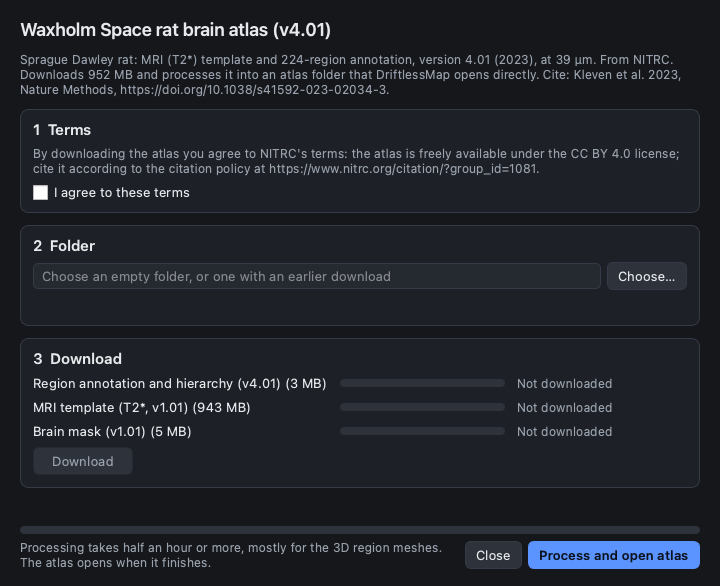
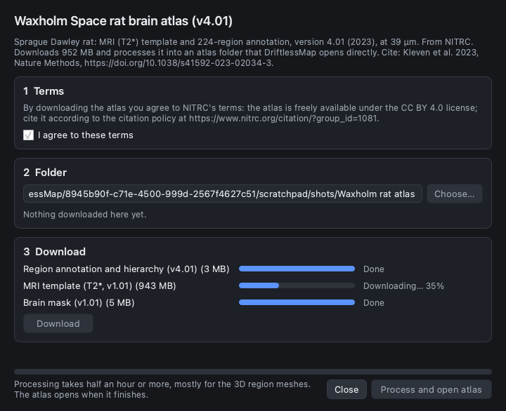
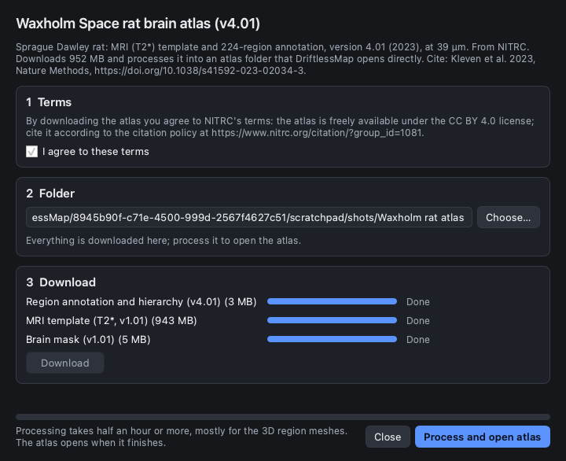
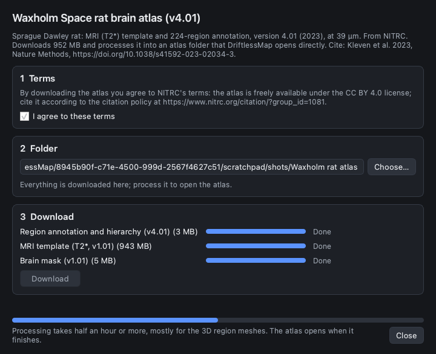
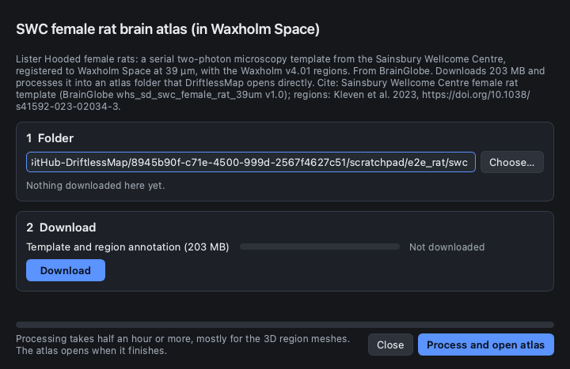
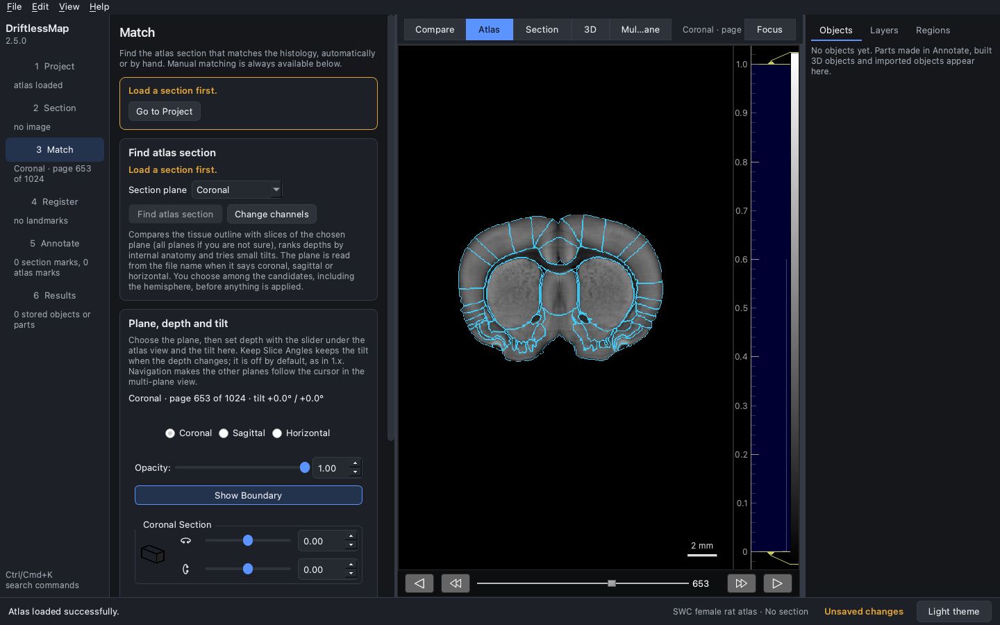

## Downloading the rat atlases

DriftlessMap 2.5 downloads and processes two rat brain atlases. Both are in
**Waxholm Space (WHS)**: the same 512 × 1024 × 512 grid of 39.0625 µm voxels,
the same Bregma and Lambda, and the same region numbers. Coordinates and
regions therefore compare directly between them.

| | Waxholm Space rat brain atlas | SWC female rat brain atlas |
| --- | --- | --- |
| Animals | Sprague Dawley rat | Lister Hooded female rats |
| Template | MRI (T2\*) | Serial two-photon microscopy, registered to WHS |
| Regions | Waxholm v4.01 (224 regions, 2023) | The same Waxholm v4.01 regions, where the template has tissue |
| Source | NITRC | BrainGlobe (`whs_sd_swc_female_rat_39um`) |
| Download | about 950 MB | about 200 MB |
| Terms | Accept NITRC's terms (CC BY 4.0; cite the atlas) | None asked |
| Cite | Kleven et al. 2023, *Nature Methods*, [doi:10.1038/s41592-023-02034-3](https://doi.org/10.1038/s41592-023-02034-3) | The SWC template (BrainGlobe) and Kleven et al. 2023 for the regions |

The SWC template is a microscopy image, so it looks more like a histology
section than the MRI template does. Choose Waxholm for the full MRI atlas; choose
SWC when your sections resemble two-photon or fluorescence images. You can
download both and switch between them with **Load atlas…**.

The screenshots were taken in the 2.0 interface of DriftlessMap 2.5.0. The
classic interface has the same downloads under **Atlas > Download Waxholm Rat
Atlas** and **Atlas > Download SWC Female Rat Atlas**. The reference description
is in the [User Manual, Section 5.2](../../MANUAL.md#52-rat-atlases).

### 1. Open the download

In the **Project** step, open **Atlas tools** and choose **Download Waxholm rat
atlas (v4.01)…** or **Download SWC female rat atlas…**. With nothing loaded
yet, the empty canvas also offers **Download rat atlas…**, which opens the
Waxholm download.

### 2. Accept the terms (Waxholm only)

NITRC shares the Waxholm atlas once you accept its terms. Read them and tick
**I agree to these terms**. **Download** stays unavailable until you do. The
SWC atlas asks for no terms, so its dialog has no Terms card.

### 3. Choose a folder and download

Click **Choose…** and pick an empty folder, or one where you downloaded the
same atlas before. Files already there with the right checksum are marked
*Already downloaded* and are not fetched again. Click **Download**. Each file
shows its own progress.

Every file is checked against the SHA-256 checksum DriftlessMap knows for it.
If a server sends something else (a changed release, or a web page instead of
the file), the download is refused with *failed SHA-256 verification* and
nothing is processed.

### 4. Process and open the atlas

Click **Process and open atlas**. DriftlessMap reads the region hierarchy
from the downloaded atlas, prepares the template and annotation, and builds
the processed volumes and the 3D region meshes. This took about 25 minutes for
each atlas on a recent Mac; leave the dialog open until it finishes. The atlas
then opens in the main window.

The SWC dialog looks the same without the Terms card. Here it was pointed at a
folder holding a finished download:

### 5. The processed atlases

The two atlases at the Bregma page (coronal page 653), with **Show Boundary**
on. The region outlines are the same Waxholm regions in both.

Waxholm (MRI template):

SWC female rat (two-photon template):

### Notes

- **Earlier Waxholm folders.** Folders downloaded before 2.5.0 hold the v4
  annotation and keep working with the labels they were processed with.
  Download v4.01 into a new folder, so projects made with v4 still find the
  atlas they were made with.
- **Projects keep their atlas.** A project records the content of the atlas it
  was made with and asks for that atlas when it opens; the other rat atlas, or
  another Waxholm release, is not accepted in its place, even though the grid
  is the same.
- **What changed in v4.01.** Three regions were added (trigeminal nerve,
  medullary spinal trigeminal tract, anterior olfactory area unspecified), the
  spinal trigeminal tract was split, and *Frontal association area 3* was
  renamed *Motor association area*.
