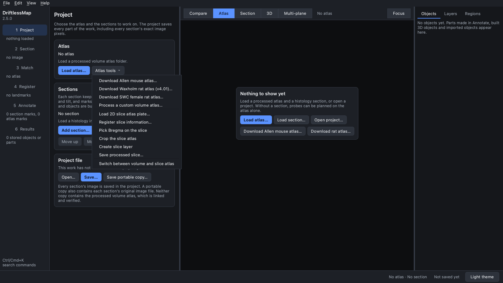
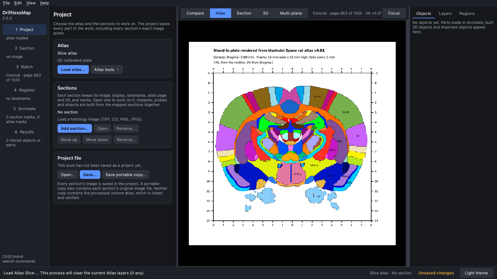
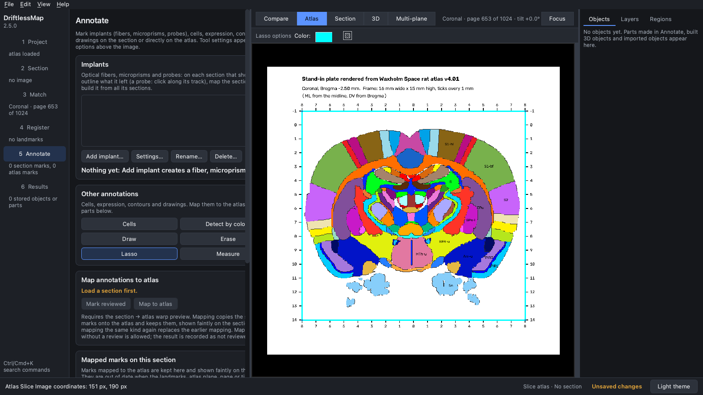
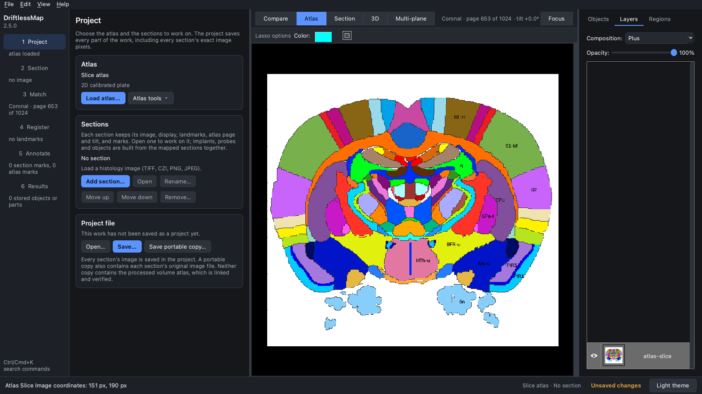
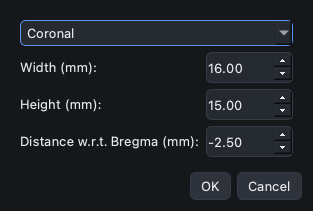
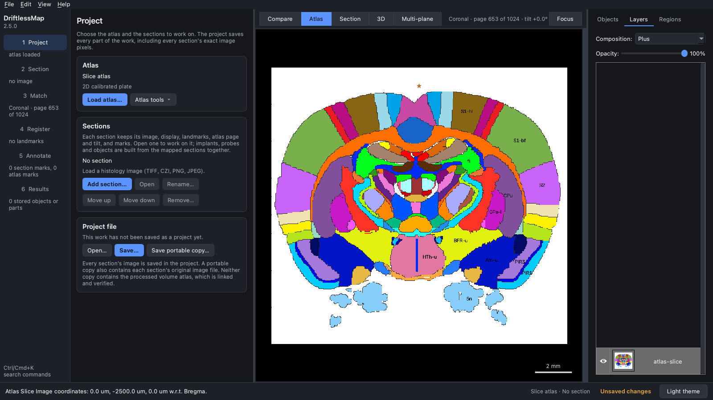
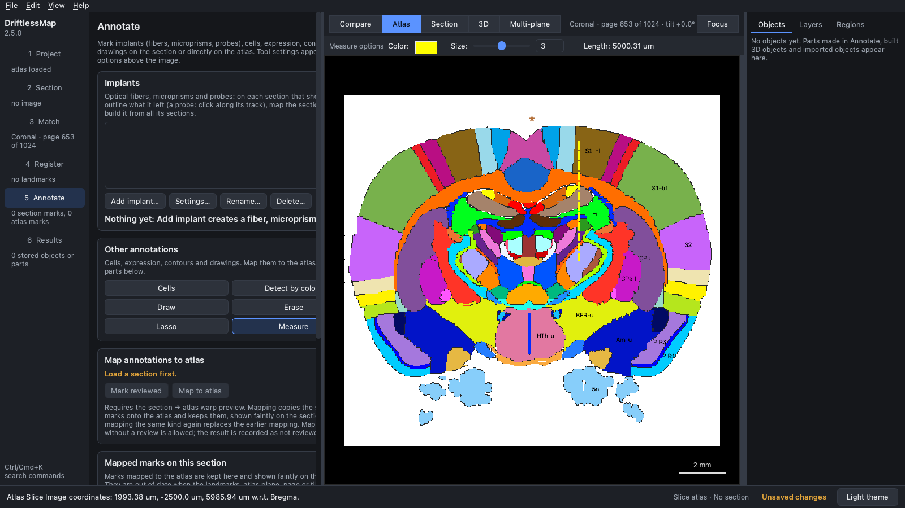

## Upload a slice atlas

Besides volume atlases, DriftlessMap works with a single atlas plate: an
image of one page of a printed atlas, as long as you are licensed to use a
digital copy of that atlas. You load the plate image, tell DriftlessMap its
cut, physical size and distance from Bregma, mark Bregma on it, and can then
measure distances in millimetres on it, or register a histology section to
it with landmarks.

Book pages cannot be shown here, so this tutorial uses a stand-in plate:
coronal page 589 of the Waxholm Space rat atlas v4.01 annotation (Bregma
−2.50 mm), rendered with the region colours like a book page: a white margin,
a title, and a 16 mm × 15 mm frame with millimetre ticks (mediolateral from
the midline along the top and bottom, depth from Bregma along the sides). You
can follow along with the same image:
[waxholm_plate_bregma_-2.50.png](../../image/atlas_related/waxholm_plate_bregma_-2.50.png).

The screenshots were taken in the 2.0 interface of DriftlessMap 2.5.0. In the
classic interface the same commands are in the **Atlas** menu (**Load Slice**,
**Register Slice Info**, **Bregma Picker**, **Crop**) and the toolbar
(**Lasso**, **Ruler**). The reference description is in the
[User Manual](../../MANUAL.md).

### 1. Load the plate

In the **Project** step, open **Atlas tools** and choose **Load 2D slice atlas
plate…**, then pick the image (JPEG, PNG, TIFF or BMP). DriftlessMap switches
to the slice atlas and shows the plate in the atlas view; the **Atlas** card
reads *Slice atlas*. Loading a plate clears any atlas layers you had.

The plate's own labels give everything DriftlessMap needs: this page is
2.50 mm posterior to Bregma, and its frame is 16 mm wide and 15 mm high.

### 2. Crop the plate to its frame

The white margin around the frame is not part of the atlas, and DriftlessMap
takes the width and height you enter in step 3 as the size of the **whole**
image. So crop the plate to exactly the area whose size you know (here the
frame) before you enter its size.

1. Go to the **Annotate** step and click **Lasso**. In DriftlessMap 2.5.0 the
   Annotate tools are available only once a volume atlas or a section is
   open. If you work with the plate alone, load the section you will compare
   with it first (**Add section…**); for these screenshots the Waxholm volume
   atlas had been loaded before the plate (which is why the header above the
   view still reads *Coronal · page 653 of 1024*: it describes the volume
   atlas, not the plate).
2. Click the four corners of the frame on the plate, then click near the
   first corner to close the lasso (an open lasso is also closed when you
   crop).

3. Back in the **Project** step, open **Atlas tools** and choose **Crop the
   slice atlas**. The plate is cut to the rectangle around the lasso, here
   962 × 901 pixels.

The cropped plate is shown as the *atlas-slice* layer. (In DriftlessMap 2.5.0
it first appeared black, because that layer was given the *Overlay*
composition; there, set it to **Plus** in the **Layers** tab.)

### 3. Register the slice information

Open **Atlas tools > Register slice information…**. In the *Current Slice
Settings* window, choose the cut (**Coronal**, **Sagittal** or
**Horizontal**) and enter the width and height of the current image in
millimetres and its distance from Bregma in millimetres (negative is
posterior for a coronal plate). Here: Coronal, 16, 15 and −2.5. Click **OK**.
The atlas view now shows a millimetre scale bar.

### 4. Pick Bregma

Choose **Atlas tools > Pick Bregma on the slice** and click the point on the
plate that lies at the midline and at Bregma's height (depth 0). A star marks
it. This point is Bregma projected onto the plate: its AP position comes from
the distance you entered in step 3, not from the click. The coordinates in the
status bar are now given in µm relative to Bregma; with the pointer on the
star it reads *0.0 um, -2500.0 um, 0.0 um w.r.t. Bregma* (ML, AP, depth below
Bregma).

If you crop after picking Bregma, DriftlessMap moves the Bregma point with the
crop. The width and height, however, are not changed by a crop, so register
them again for the cropped image.

### 5. Measure with the ruler

Working on a plate differs from working with a volume atlas: there are no 3D
objects or merged probes. To know, for example, how far a planned track runs
through each region, measure it with the ruler. In the **Annotate** step click
**Measure** (or press **M**), click where the track starts, move to where it
ends and click again. The length appears in the **Measure options** above the
view, and the status bar shows the clicked position relative to Bregma.

Here a vertical track 2 mm right of the midline was measured from 1 mm to
6 mm below Bregma, two ticks of the plate's frame. The ruler reports
5000.31 µm, and the end point is at 1993.38 µm ML, −2500.0 µm AP and
5985.94 µm depth.

A third click clears the ruler for the next measurement.

### 6. Keep the processed plate

**Atlas tools > Save processed slice…** saves the cropped plate with its
information and Bregma point as a `.dmapslice` file, which **Load 2D slice
atlas plate…** opens again ready to use (DriftlessMap saves it only once the
slice information and Bregma are set). Legacy HERBS slice files
(`.herbsslice`, `.pkl`) can still be opened. **Atlas tools > Switch between
volume and slice atlas** goes back to a volume atlas you loaded before the
plate. A project saves the plate's pixels with the project.
