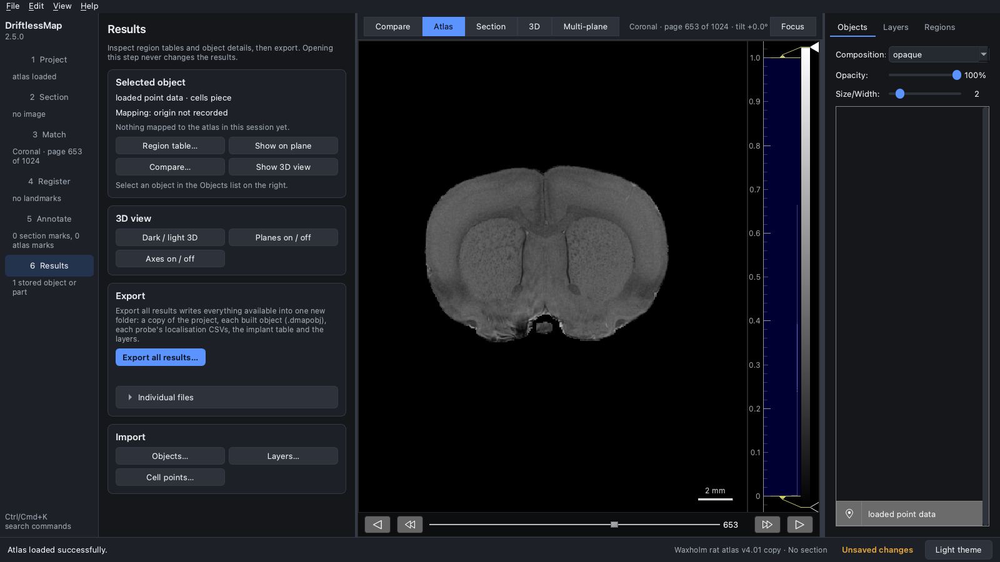
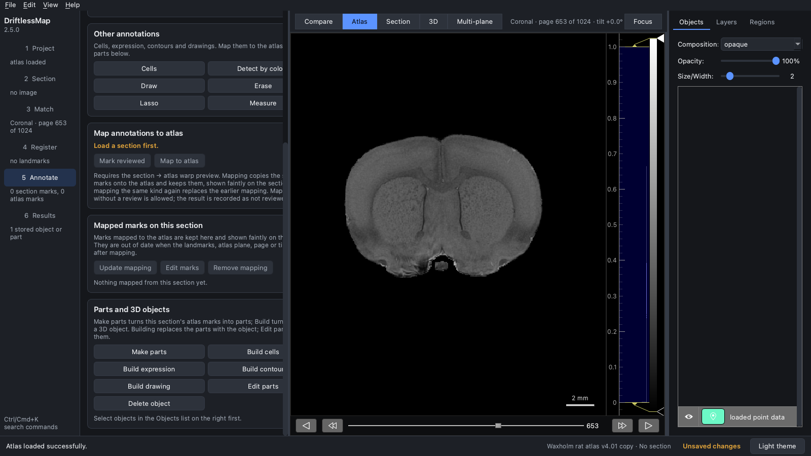
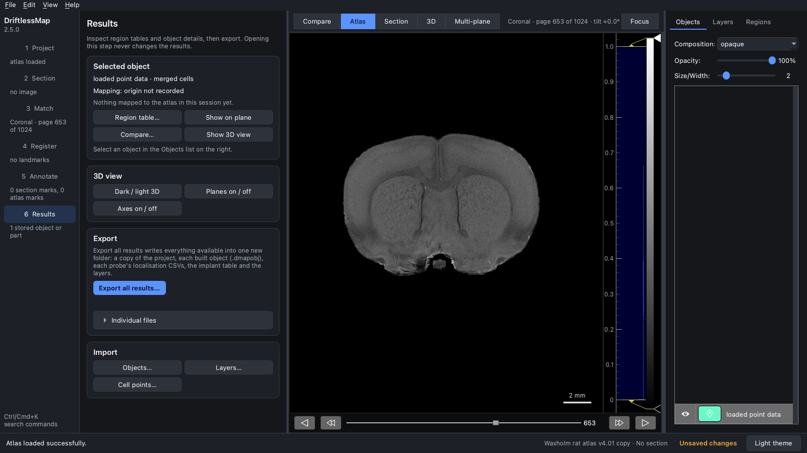
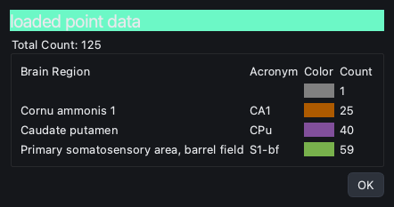

## Upload external cell points

Many programs find cell positions in an atlas automatically. DriftlessMap
loads such cell points, counts them per brain region and shows them with your
other objects. Read
[Important to know before you upload external data](important_to_know_before_you_start.md)
first: the atlas folder must contain `atlas_axis_info.pkl`.

### The points file

Save the points as a NumPy file (`.npy`): a numeric array of shape (n, 3),
one row per cell. Legacy HERBS point files (`.pkl`) are also read. Each row is
a position in **voxels of the atlas's own volume file**, in that file's axis
order; every value must lie inside the volume (from 0 up to, but not
including, the size of that axis). Integer values are voxel indices.

This tutorial uses a small synthetic set: 125 voxels picked at random from
the Waxholm v4.01 annotation in the right hemisphere, between coronal pages
560 and 619 (about 1.3 to 3.6 mm behind Bregma): 60 in the primary
somatosensory barrel field (S1-bf), 40 in the caudate putamen (CPu) and 25 in
CA1. Waxholm volume files are 512 × 1024 × 512 voxels with x from left to
right, y from posterior to anterior and z from inferior to superior, so the
first column lies in [0, 512), the second in [0, 1024) and the third in
[0, 512). The first rows are:

| x | y | z |
| --- | --- | --- |
| 391 | 567 | 386 |
| 407 | 597 | 358 |
| 373 | 607 | 354 |
| ... | ... | ... |
| 280 | 584 | 361 |

```python
import numpy as np

points = np.array([[391, 567, 386], [407, 597, 358], [373, 607, 354]], dtype=float)
np.save("cells.npy", points)   # shape (n, 3)
```

The screenshots were taken in the 2.0 interface of DriftlessMap 2.5.0, with
the Waxholm rat atlas v4.01 (a folder that has `atlas_axis_info.pkl`, as every
rat atlas processed by 2.5.1 or later does). In the classic interface the command is
**File > Load External Data > Cells**.

### 1. Load the points

Load the atlas the points belong to. In the **Results** step, under
**Import**, click **Cell points…** (or **File > Import > External cell
points…**) and choose the file. DriftlessMap converts the points to its own
coordinates and adds them as a cells part named *loaded point data* to the
**Objects** list on the right.

<p align="center">

</p>

If the file cannot be used, the status bar says why and nothing is added:
for example, points outside the volume give *Point coordinates must lie inside
the source atlas volume (512, 1024, 512) in its native voxel order.*

### 2. Build the cells object

Go to the **Annotate** step and click **Build cells** in the **Parts and 3D
objects** card. The cells part becomes a *merged cells* object, and
DriftlessMap looks up the region of every cell.

<p align="center">

</p>

<p align="center">

</p>

### 3. See the region counts

Back in the **Results** step, with the object selected, click **Region
table…**. The window lists the total count and the number of cells in each
region. (The region table opens for built objects, not for parts.)

<p align="center">

</p>

The counts match how the points were made: 25 in CA1, 40 in the caudate
putamen and 59 of the 60 barrel-field points in S1-bf. The remaining point
(x 433, y 571, z 353) is labelled S1-bf in the annotation file but lies just
outside the Waxholm brain mask, and the processed atlas clears every label
outside the mask; it is counted on the row without a region name.

**Show 3D view** (or the **3D** view button) shows the cells in the 3D
atlas, and the object is saved with the project. To share it as a `.dmapobj` file, use
**Results > Export**: **Export all results…**, or **Individual files >
Selected object…**.
