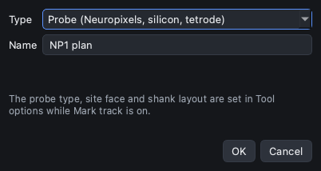
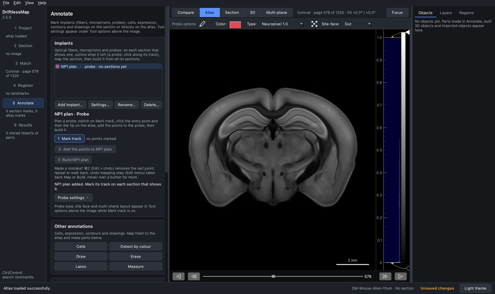
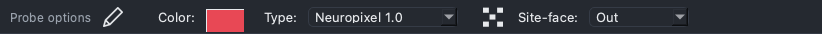
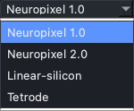
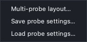
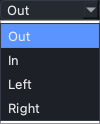
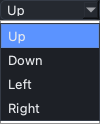
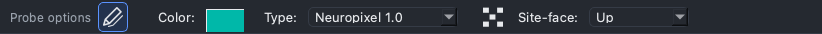

## Important things to know before you start

This tutorial describes probe work in the DriftlessMap 2.5 interface (the
default "2.0" interface). The probe tutorials that follow build on it:

1. Important things to know before you start (this page)
2. [Pre-plan a Neuropixels 1.0 probe](2-Pre-Plan_NP1.md)
3. [Pre-plan a Neuropixels 2.0 probe, single shank and 4 shanks](3-Pre-Plan_NP2.md)
4. [Design a linear silicon probe](4-Design_Linear_Silicon_Probe.md)
5. [Multi-shank and multi-probe layouts](5-Design_multi_shanks_Probes.md)

The screenshots use the Allen mouse atlas (CCFv3, 10 µm), processed and
loaded in the **Project** step. Any processed volume atlas works the same way.

### Pre-surgery and after-surgery mode

DriftlessMap decides the mode from what is loaded:

With ONLY a volume atlas loaded (no section), you are in pre-surgery (planning) mode.

With a volume atlas AND a histological section loaded, you are in after-surgery (reconstruction) mode.

So, to plan coordinates before a surgery, do not load a section. The probe
controls say which mode you are in:

- **Pre-surgery:** "Plan a probe: switch on Mark track, click the entry point
  and then the tip on the atlas, add the points to the probe, then build it."
  The second button reads **Add the points to *probe name***. A plan is exactly
  two points.
- **After surgery:** "On each section that shows the track: switch on Mark
  track, click along the track, then map the section. Build the probe when all
  its sections are mapped." The second button reads **Map this section**, which
  maps the marks through the section's registration (Register step). A track
  can be collected over several sections; at least two points are needed on a
  section.

### Where the probe controls are

Probes live in the **Annotate** step, in the **Implants** card, together with
optical fibers and microprisms.

1. Click **Add implant…**, choose the type **Probe (Neuropixels, silicon,
   tetrode)** and give the probe a name. Names cannot contain "-" and cannot end
   in "shank" followed by a number, because DriftlessMap uses those to group the
   parts of a probe and its shanks.

2. Select the probe in the list. Its controls appear below the list:
   **1 Mark track**, **2 Add the points to … / Map this section**,
   **3 Build …**, and the **Probe settings** menu.

3. Switch on **1 Mark track**. This is the Probe Marker tool of DriftlessMap
   1.x: while it is on, the probe options appear in **Tool options** above the
   image, and clicks on the atlas (or section) place probe points.

The Tool options strip holds, from left to right:

- **Multi-shanks switch** (pencil icon; it shows several pencils when on). See
  [tutorial 3](3-Pre-Plan_NP2.md) and [tutorial 5](5-Design_multi_shanks_Probes.md).
- **Color** of the marks. Each probe gets its own colour in the Implants list
  and that colour is used when you switch on Mark track; you can change it here.
- **Type**: Neuropixel 1.0, Neuropixel 2.0, Linear-silicon or Tetrode.
- **Merge sites** (dotted icon): draws contacts at the same depth as one site
  in the probe's schematic. It changes only the drawing, not the contact table
  of the reconstruction. It is read when the probe is built.
- **Site-face**: the direction the recording sites face (below).
- **Linear Silicon Designer** (list icon at the right end), shown only when the
  type is Linear-silicon ([tutorial 4](4-Design_Linear_Silicon_Probe.md)).

The Tool options are shared by all probes: set the type, face and shank
layout before you mark each probe. The **Probe settings** menu in the probe
controls holds the rest: **Multi-probe layout…** (tutorial 5), and
**Save probe settings…** / **Load probe settings…**, which store and restore the
complete probe setup (type, geometry, face, multi-probe layout, merge-sites
choice) as a `.dmapprobe` file.

### The probe model

The probe Type defines the geometry of a single shank.

The electrode layouts of Neuropixels 1.0 and 2.0 are built in:

| Type | Built-in geometry |
| --- | --- |
| Neuropixel 1.0 | 10 mm shank, 175 µm tip, 24 µm thick; 960 sites in 4 staggered columns of 240 (40 µm apart within a column, a row every 20 µm), 16 × 20 µm sites |
| Neuropixel 2.0 | 10 mm shank, 175 µm tip, 24 µm thick; 960 sites in 2 columns of 480 (15 µm apart within a column), 16 × 15 µm sites; the multi-shank switch makes it the 4-shank version with shanks 250 µm apart |
| Linear-silicon | your own design ([tutorial 4](4-Design_Linear_Silicon_Probe.md)) |
| Tetrode | a simple straight track: no shank thickness and no fixed length, for tetrodes or other tracks without a modeled probe body |

Choosing *Neuropixel 2.0* gives the single-shank probe. For the 4-shank
version, turn on the multi-shanks switch as well.

A probe is modeled as a rigid 3D shank with the recording sites on one face.
The track you click is taken as the centre line of the probe.

### Site face

The **Site-face** box has different choices before and after surgery,
because the reference is different.

&nbsp;&nbsp;&nbsp;&nbsp;

**Pre-surgery (Out, In, Left, Right)** refers to the section you plan on, as you
look at it on the screen. *Out*: the sites face you (out of the screen). *In*:
the sites face away from you. *Left* and *Right*: the sites face the left or
right side of the view. In a coronal view the animal's right is on the right of
the screen, so *Out* points posterior and *In* anterior.

**After surgery (Up, Down, Left, Right)** refers to how you held the probe
during the surgery. The four choices are quarter turns of the probe about its
own axis: *Down* is the opposite of *Up*, *Left* and *Right* are turned 90° to
either side.

When a section is loaded the box switches to the after-surgery choices:

### After building

**3 Build** turns the probe's parts into a 3D probe in the **Objects** panel.
The probe controls then show **Region table…**, which opens the probe
information window (tilt, insertion and tip coordinates, fit quality, regions
and contacts per region, and **Export probe localization files**), and
**Show in 3D**. If you mapped more sections after building, the button reads
**Rebuild**. **Delete…** in the Implants card removes a probe with its parts,
built object and mapping records; **Undo mapping step** (Edit menu) takes back
Add/Map and Build, and Ctrl+Z (Cmd+Z on macOS) removes the last probe point
while you mark.

Plan in the **Atlas** view (one plane). The **Multi-plane** view does not take
probe clicks, and probes cannot be built while it is shown.
