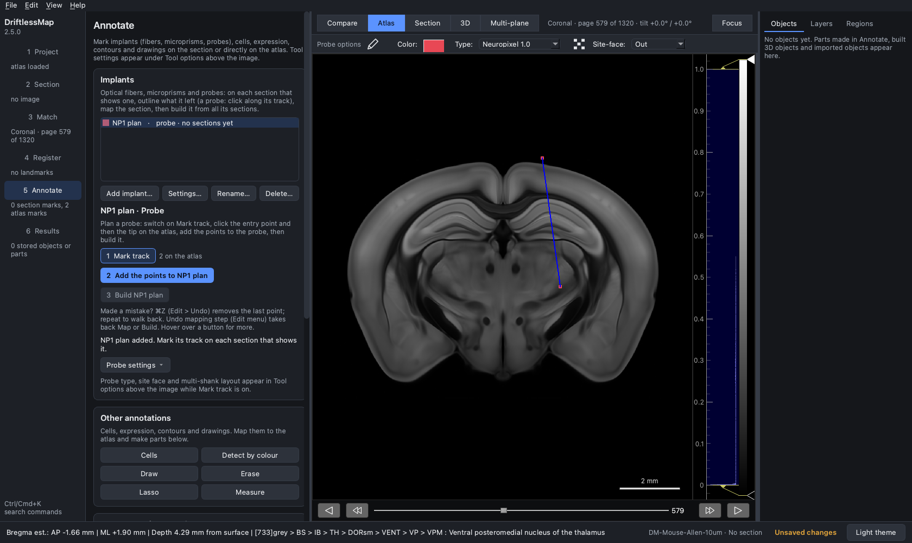
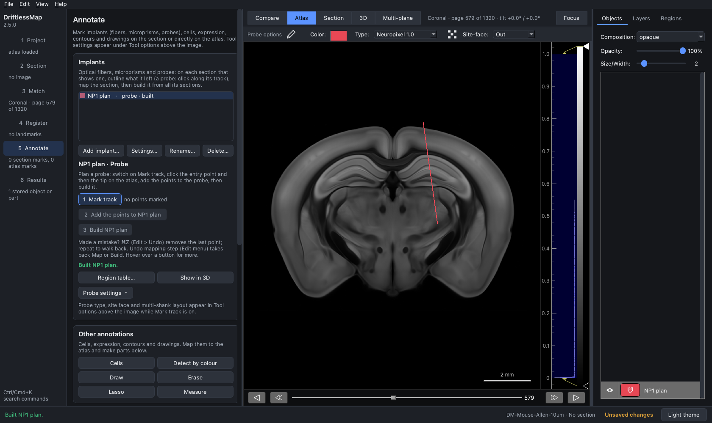
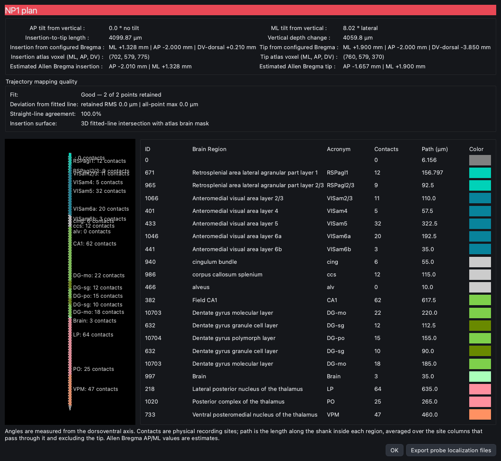

## Pre-plan a Neuropixels 1.0 single-shank probe

The electrode layout of Neuropixels 1.0 is built into DriftlessMap (see
[Important things to know before you start](1-Important_to_know_before_you_start.md)).
For the probe itself, see the Neuropixels 1.0 user manual:
https://alleninstitute.org/media/filer_public/19/ff/19ff8b8b-9959-4944-a9c0-61006b4a0148/neuropixels_user_manual.pdf

To plan probe coordinates before a surgery:

1. **Load the atlas only.** In the **Project** step, load a processed volume
   atlas. Do not load a section: with no section loaded, DriftlessMap is in
   pre-surgery mode. The screenshots use the Allen mouse atlas (10 µm).

2. **Choose the plane.** In the **Match** step choose the atlas plane (coronal,
   sagittal or horizontal) and, if you want an angled plane, the tilt. Then go
   to the **Annotate** step, show the **Atlas** view and move to the page that
   contains your target with the slider under the image. Hovering over the
   atlas shows the coordinates relative to Bregma, the depth from the brain
   surface and the region at the pointer in the status bar. Here: coronal page
   579, about 2 mm posterior to Bregma (Allen Bregma values are estimates).

3. **Add the probe.** In the **Implants** card click **Add implant…**, choose
   **Probe (Neuropixels, silicon, tetrode)** and name it (here "NP1 plan").

4. **Set the probe options.** Switch on **1 Mark track**. In **Tool options**
   above the image keep **Type** at *Neuropixel 1.0*, and choose the
   **Site-face** (pre-surgery: Out, In, Left or Right) and, if you like, the
   **Color**. Leave the multi-shanks switch off for a single probe.

5. **Click the entry point and the tip** on the atlas. After the first click a
   line follows the pointer; the second click fixes it.

   - The more dorsal of the two points is taken as the entry; when the probe is
     built, the entry is moved along the line to where it meets the atlas brain
     surface. The other point is the tip. A track longer than the probe
     (10 mm for Neuropixels) is shortened to the probe length.
   - A third click clears both points so that you can start again;
     Ctrl+Z (Cmd+Z) removes the last point.

6. **Click 2 Add the points to NP1 plan.** The two points become the probe's
   part. A planned probe is exactly one two-point part.

7. **Click 3 Build NP1 plan.** The probe is built and listed in the
   **Objects** panel.

8. **Check the plan.** Click **Region table…** to open the probe information
   window: AP and ML tilt from vertical, insertion-to-tip length, vertical depth
   change, insertion and tip relative to the configured Bregma (and the
   estimated Allen Bregma for CCFv3), the atlas voxels, the fit quality, and
   for each region crossed the number of contacts and the path length along
   the shank. **Export probe localization files** writes the contacts, track,
   trajectory and region CSV files. **Show in 3D** shows the probe in the 3D
   view.

   This plan enters at ML +1.33 mm, AP −2.00 mm and reaches its tip at
   ML +1.90 mm, 3.85 mm below Bregma, tilted 8° laterally: 4.1 mm of the shank
   is in the brain, crossing retrosplenial and visual cortex, CA1, the dentate
   gyrus and the thalamus (LP, PO, VPM).

A planned probe is one part. To change a plan, click two new points and
**Add the points** again: since DriftlessMap 2.5.7 they replace the earlier
plan (and its build; the message says so), and you build it again. (In 2.5.0
the probe got a second part and building stopped with "a pre-surgery plan can
be merged from only one piece".) To keep a
plan for another session, save the project; **Probe settings > Save probe
settings…** saves the probe setup on its own (`.dmapprobe`).
