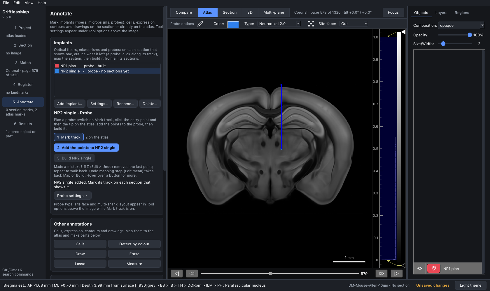
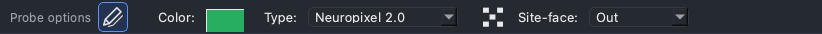
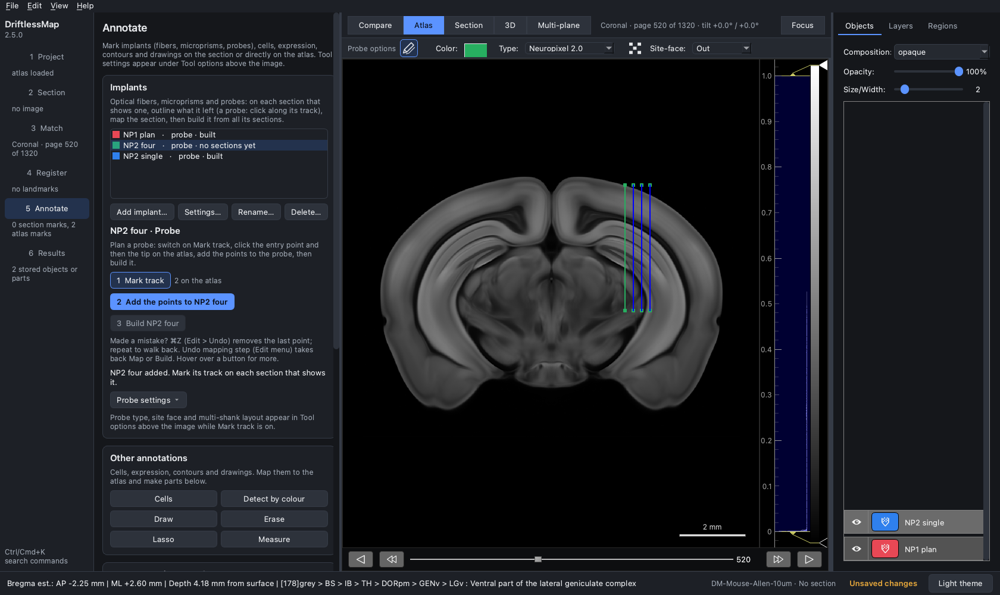
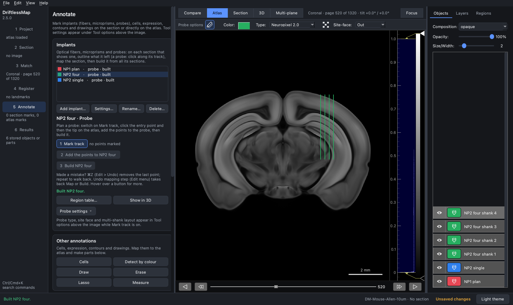

## Pre-plan a Neuropixels 2.0 probe: single shank and 4 shanks

The electrode layout of Neuropixels 2.0 is built into DriftlessMap: one shank
has two columns of 480 sites, and the 4-shank version has four such shanks
250 µm apart (centres at −375, −125, +125 and +375 µm from the probe centre).
The workflow is the same as for
[Neuropixels 1.0](2-Pre-Plan_NP1.md); only the Tool options differ.

### Single shank

1. Load a processed volume atlas in the **Project** step, and no section, so
   that DriftlessMap is in pre-surgery mode. Choose the plane (and tilt) in the
   **Match** step, then go to **Annotate**, show the **Atlas** view and move to
   the target page.

2. In the **Implants** card, **Add implant…** a probe (here "NP2 single") and
   switch on **1 Mark track**.

3. In **Tool options** choose *Neuropixel 2.0* as **Type** and set the
   **Site-face**. Keep the multi-shanks switch off.

4. Click the entry point and the tip on the atlas.

5. Click **2 Add the points to NP2 single**, then **3 Build NP2 single**.

### Four shanks

1. Add another probe (here "NP2 four") and switch on **1 Mark track**.

2. In **Tool options** choose *Neuropixel 2.0* and turn on the
   **multi-shanks switch** (the pencil at the left; it shows several pencils
   when on). Set the **Site-face**.

3. Click the entry point and the tip of the probe **centre**. The four shanks
   are drawn around it, in the plane of the view.

4. Click **2 Add the points to NP2 four**. Each shank becomes a part
   ("NP2 four shank 1 - piece" … "shank 4 - piece"). Click **3 Build NP2 four**:
   each shank is built as its own probe, "NP2 four shank 1" to "NP2 four
   shank 4", with its own region table.

Notes:

- The shank row lies in the plane of the view for every site face. With
  *Out* or *In*, the shanks run across the view and the 2D preview draws all
  four. With *Left* or *Right*, the sites face sideways in the view; the four
  shanks are still made in the plane, but the preview draws only one line, so
  check the parts or the built shanks (for example in 3D).
- Set the type, the switch and the site face before you click the points.
  Changing the type clears points already placed; changing the site face only
  hides their drawing (the points stay and are still used).
- The multi-shanks switch and the shank layout are shared by all probes. Turn
  the switch off (while Mark track is on) before planning a single-shank probe.
  When you switch from Neuropixel 2.0 to another type with the switch on, the
  4-shank layout stays as the multi-probe layout until you change it under
  **Probe settings > Multi-probe layout…** (see
  [tutorial 5](5-Design_multi_shanks_Probes.md)).
