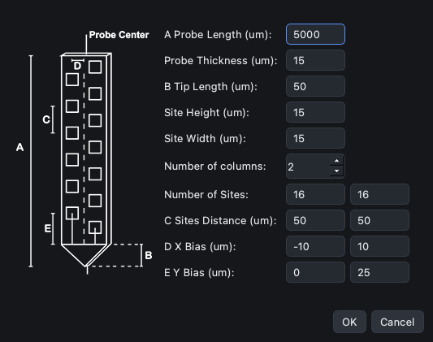
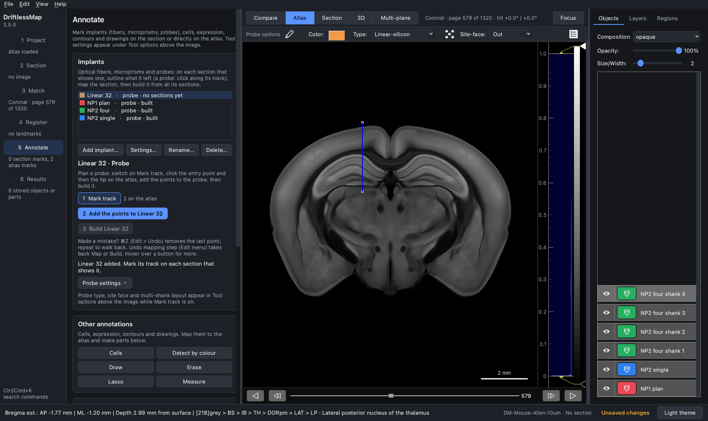
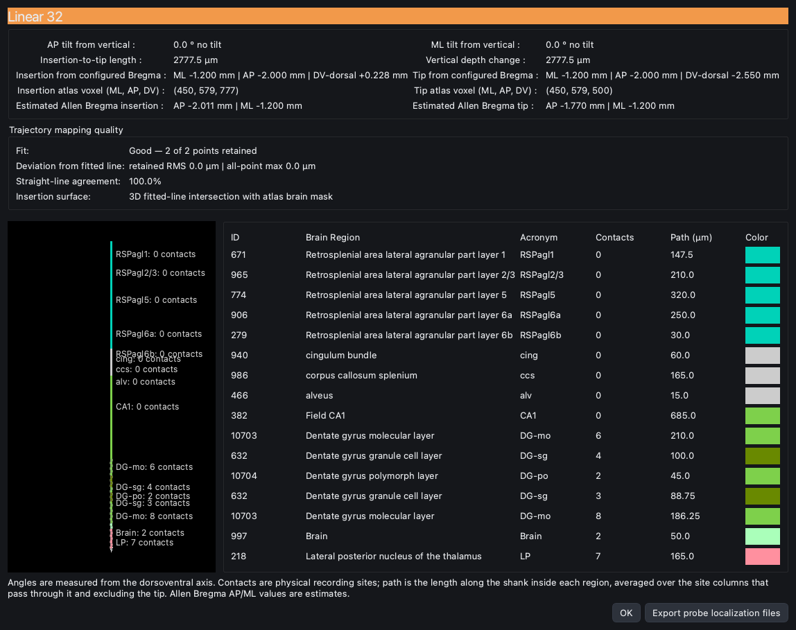

## Design the geometry of a linear silicon probe

Besides Neuropixels 1.0 and 2.0, DriftlessMap can model a linear silicon probe
of your own design: one shank with one or more columns of sites.

1. Load the atlas, choose the plane and add a probe in the **Implants** card of
   the **Annotate** step as in [tutorial 2](2-Pre-Plan_NP1.md) (here
   "Linear 32"). Switch on **1 Mark track**.

2. In **Tool options** choose *Linear-silicon* as **Type**. The
   **Linear Silicon Designer** button (list icon) appears at the right end of
   Tool options.

3. Click the **Linear Silicon Designer** button. Enter the design and click
   **OK**. The drawing on the left shows what each letter means:

   | Field | Meaning |
   | --- | --- |
   | A Probe Length (µm) | overall length of the shank, tip included |
   | Probe Thickness (µm) | thickness of the shank |
   | B Tip Length (µm) | length of the tapered tip; it must lie within the probe length |
   | Site Height / Site Width (µm) | size of one recording site; both must be above 0 |
   | Number of columns | columns of sites (1 to 10); one entry per column in the rows below |
   | Number of Sites | sites in the column (fewer are modeled if they do not fit on the shank) |
   | C Sites Distance (µm) | distance between neighbouring sites in the column |
   | D X Bias (µm) | sideways offset of the column from the probe centre line (may be negative) |
   | E Y Bias (µm) | height of the column's first (deepest) site above the base of the tip; 0 or more |

   **OK** is available only when every field is valid. The example is a
   32-site probe: 5 mm long, 15 µm thick, 50 µm tip, 15 × 15 µm sites, two
   columns of 16 sites 50 µm apart, 10 µm either side of the centre line, the
   second column shifted 25 µm up.

4. Set the **Site-face**, click the entry point and the tip on the atlas, then
   **2 Add the points to Linear 32** and **3 Build Linear 32**, exactly as for a
   Neuropixels probe. A track longer than the probe length you entered is
   shortened to it.

5. **Region table…** shows where the 32 sites lie. Here the tip is 2.78 mm
   below the surface and all the sites are in the deepest 0.85 mm of the track
   (dentate gyrus and the lateral posterior thalamus); the cortex and CA1 above
   are crossed by the shank but hold no sites.

To reuse a design, save it with **Probe settings > Save probe settings…**
(`.dmapprobe`) and load it later with **Load probe settings…**; check every
field after loading. The design is also saved in the project.

The designer always opens with the current geometry; **Cancel** leaves it
unchanged. When you first switch to *Linear-silicon*, that geometry is the one
of the type selected before (for example the four Neuropixels 1.0 columns), and
it is used as it is until you change it in the designer, so always open the
designer and check every field.
