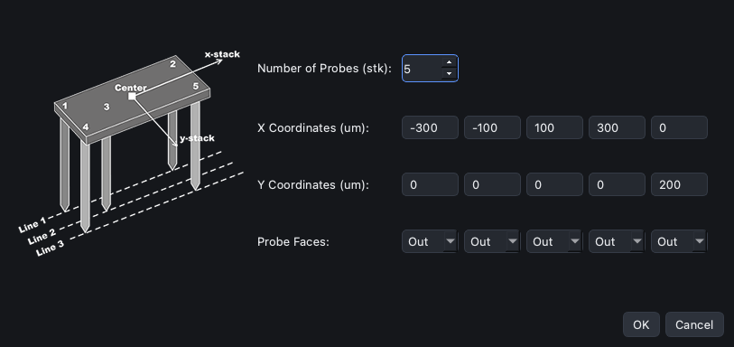
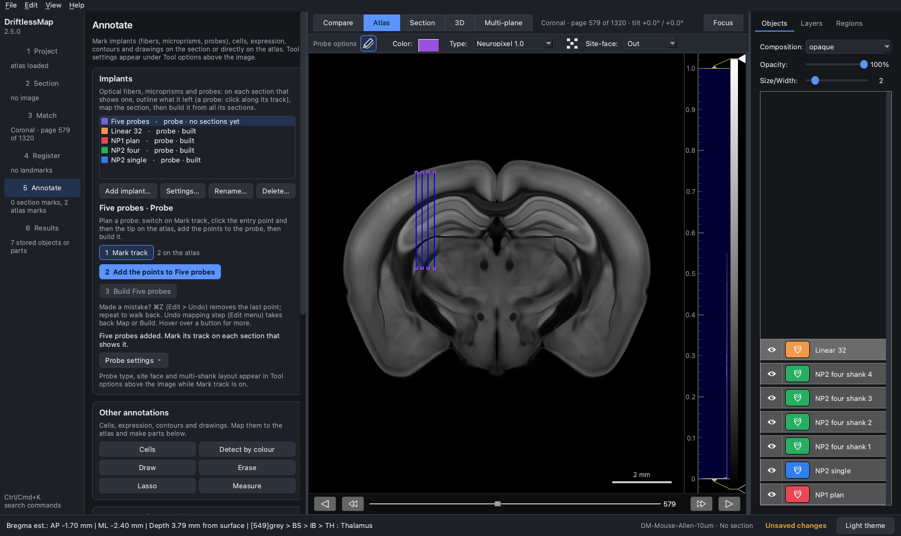
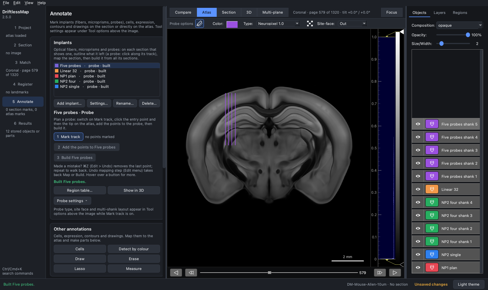

## Multi-shank and multi-probe layouts

Besides the built-in 4-shank Neuropixels 2.0 ([tutorial 3](3-Pre-Plan_NP2.md)),
DriftlessMap can plan any arrangement of shanks or probes that move together,
for example several probes on one holder. Each shank or probe in the layout
has the geometry of the selected probe **Type**.

### The layout

A layout lists, for each shank, its position relative to the probe centre (the
track you click) and the direction its sites face:

- **X** (µm) runs across the view, in the plane you plan on. With
  **Site-face** *Out*, positive X is to the right of the view.
- **Y** (µm) runs out of that plane. Positive Y is the side the sites face: with
  *Out*, towards you. In a coronal view, where the animal's right is on the
  right of the screen, that is posterior: in the example below the probe at
  Y = 200 µm lies 200 µm posterior of the others.
- The **Site-face** box in Tool options turns the whole layout: *In* turns it by
  180° (positive X to the left, positive Y away from you), *Left* and *Right*
  by 90°.
- **Probe Faces** gives each shank's own site face (Out, In, Left, Right). When
  the multi-shanks switch is on and the layout is valid, these, not the
  Site-face box, set the direction of each shank's sites in the built probes.

The layout is used only for planning. After surgery each shank is traced on
the sections it crosses: add one probe per shank in the Implants card and
mark, map and build each one.

### Plan a layout

1. Load the atlas only (no section), choose the plane, go to **Annotate** and
   show the **Atlas** view, as in [tutorial 2](2-Pre-Plan_NP1.md).

2. **Add implant…** a probe (here "Five probes") and switch on
   **1 Mark track**. In **Tool options** choose the **Type** (here
   *Neuropixel 1.0*) and the **Site-face**, and turn on the **multi-shanks
   switch**.

3. Open **Probe settings > Multi-probe layout…** in the probe controls. Set the
   **Number of Probes** and the X, Y and face of each one, then click **OK**.
   If two probes have the same X and Y, the message "There are at least 2
   probes located at the same location." appears and the layout is not used.
   Here: five Neuropixels 1.0 probes, four in a row across the view
   (X = −300, −100, 100, 300 µm, Y = 0) and one 200 µm out of the plane
   (X = 0, Y = 200 µm), all facing *Out*.

4. Click the entry point and the tip of the probe **centre** on the atlas. Only
   the probes with Y = 0 lie in the plane you see, so here four lines are drawn.

5. Click **2 Add the points to Five probes**. One part is made for every probe
   in the layout, five here ("Five probes shank 1 - piece" …
   "shank 5 - piece"), including the one out of the plane.

6. Click **3 Build Five probes**. Each probe is built on its own, "Five probes
   shank 1" to "Five probes shank 5", each with its own region table
   (**Region table…** opens the last one; the others are in the **Objects**
   panel).

Notes:

- The multi-shanks switch, the layout and the Site-face box are shared by all
  probes. Turn the switch off (while Mark track is on) before planning a single
  probe. A probe type's own shank layout (Neuropixel 2.0) is not carried over
  to another type.
- With *Neuropixel 2.0* the switch loads the built-in 4-shank layout, and it is
  loaded again whenever you select *Neuropixel 2.0*, change the site face or
  turn the switch on. To use your own layout with Neuropixels 2.0 shanks, set
  the type, face and switch first and open **Multi-probe layout…** last.
- **Probe settings > Save probe settings…** saves the layout with the rest of
  the probe setup (`.dmapprobe`); the project saves it too.
