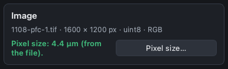
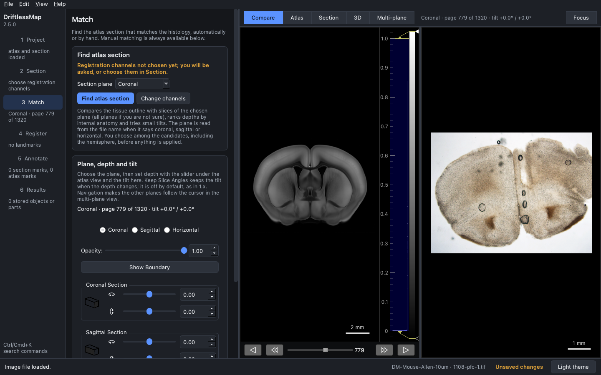
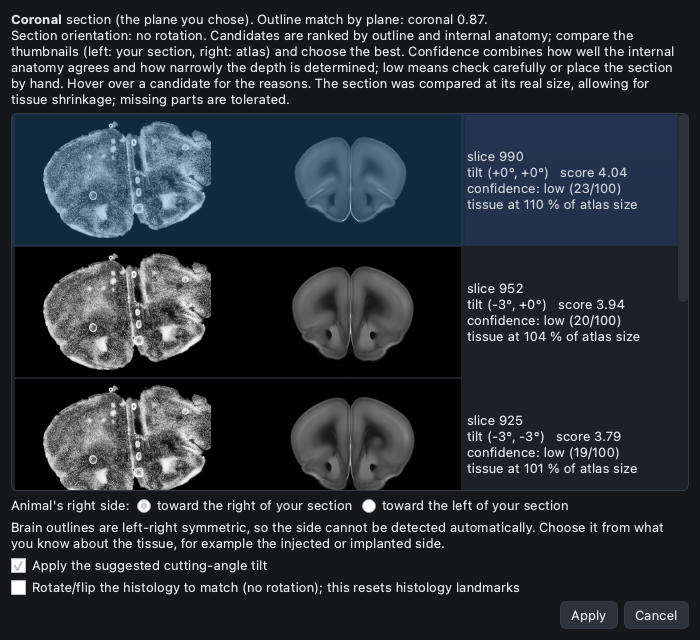
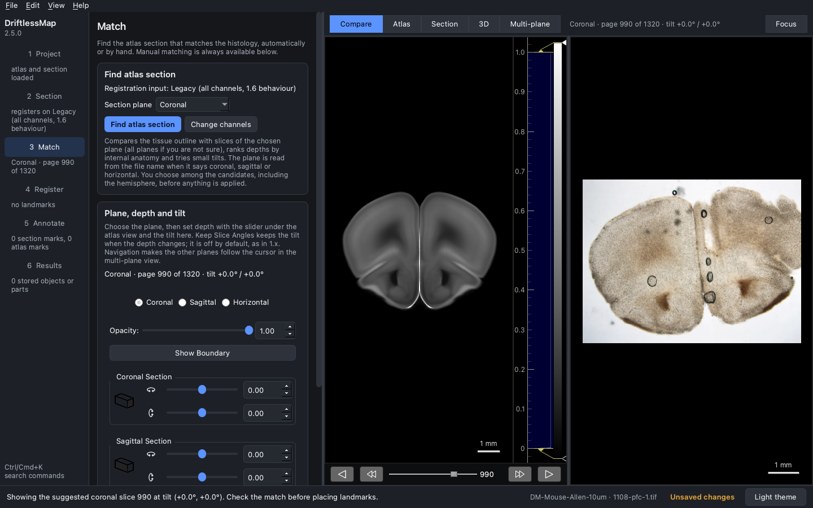
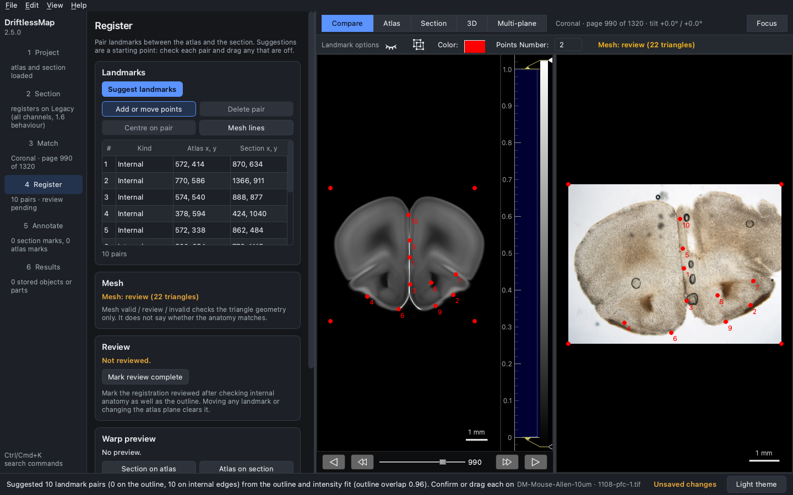
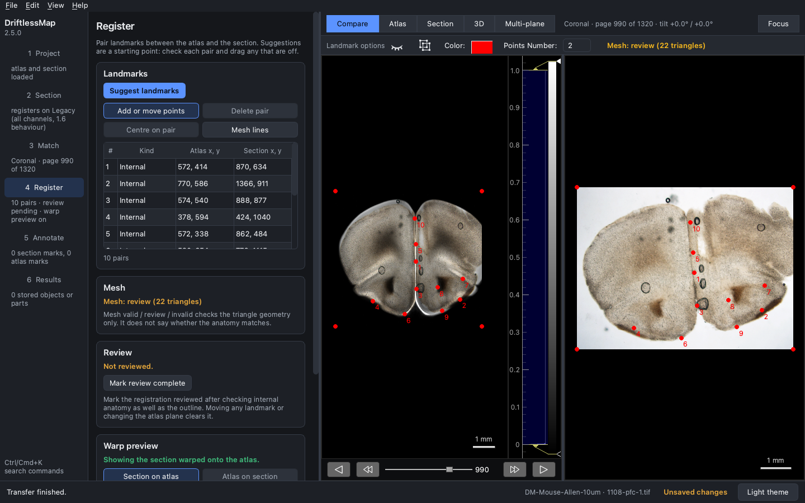
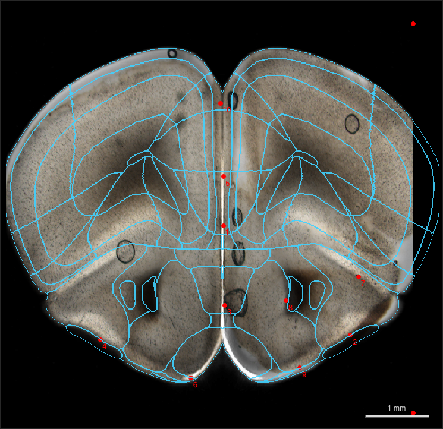
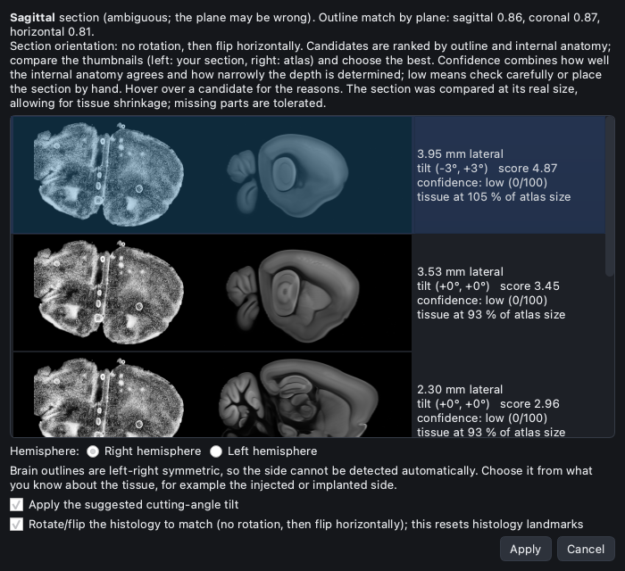

## Automatic Section Matching and Landmark Proposal

DriftlessMap can suggest a starting point for registering a histological
section to a volume atlas. It does this in two steps:

- **Find atlas section** (Match step; classic interface: **Atlas > Suggest
  Atlas Section...**) finds the atlas depth, cutting angle and image
  orientation that best match the section, in the plane you name.
- **Suggest landmarks** (Register step; classic interface: **Atlas > Propose
  Landmarks**) fits the chosen atlas slice to the section and fills in the
  landmark list with landmark pairs.

Both steps only suggest. You confirm the section, review the landmarks, and
nothing is mapped to the atlas until you ask for it.

This tutorial uses a single coronal brightfield section of a mouse brain
through the prefrontal cortex (1600 × 1200 pixels, RGB, 4.4 µm per pixel)
with the Allen mouse atlas at 10 µm. The screenshots were taken in the 2.0
interface of DriftlessMap 2.5.0, with the objects and layers column hidden
(**View > Show objects and layers**) to give the views more room. The User
Manual has the reference description in
[Section 8.2](../../MANUAL.md#82-suggest-the-section-and-landmarks-automatically).

### Before you start

The automation works best on:

- one section per image, on a plain dark or light background;
- an image with a known pixel size (see below);
- an image cropped to roughly the section, without labels or scale bars.

The section outline is found by thresholding, so debris, bubbles or a second
section in the image will change the outline that is compared. Brightfield
sections (dark tissue on a bright slide), like the sample, are recognised from
their bright border and compared as bright tissue on black, like the atlas
template. Sections missing a part are handled when the pixel size is known:
in the sample, the right edge of the tissue runs off the image.

**Registration channels.** For a multichannel image, tick the channels to
register on in the Section step (for example DAPI only), so a bright tracer
channel does not change the outline or the match. An RGB image such as the
sample uses **Legacy** (all channels, as in DriftlessMap 1.6) without
asking, and the Match step then names the input it used.

**Pixel size.** The section is compared with the atlas at its real size. CZI
files and most microscope TIFFs record their pixel size, which the Image card
of the Section step shows; the scale bar on the histology view uses it too.

If the file records none, press **Pixel size…** there and enter micrometres
per pixel; otherwise Find atlas section asks for it.

### 1. Load the atlas and the section

Load the processed volume atlas and the section in the Project step
(**Load atlas…** and **Add section…**). The section does not need to be
rotated or flipped first, and the atlas can show any page.

Here the Match step is open. The atlas shows coronal page 779 of 1320, the
page it opened on, and the section is on the right. The Find atlas section
card notes that the registration channels are not chosen yet: for this RGB
image, Legacy is used without asking.

### 2. How the section is found

In the Match step, choose the **Section plane** the section was cut in and
press **Find atlas section**. The plane is read from the image file name when
it says coronal, sagittal or horizontal; the sample's name does not, and
Coronal, the first choice, is kept. The comparison runs in the background behind a
"Comparing the section with the atlas..." progress window. On the sample it
took about 20 seconds on an Apple M3 Max. It has three stages.

**Stage 1: the orientation (and, if you are not sure, the plane), from the
outline.** DriftlessMap finds the tissue outline and compares it with the
outlines of atlas slices, scaled to a common size, in all eight rotations and
flips of the section. The score is the overlap of the two outlines
(intersection over union; 1.0 means identical). Coronal and sagittal sections
are kept upright unless another orientation fits the outline clearly better.
On the sample, the best upright coronal outline scores 0.87, and the section
needs no rotation.

The search stays in the plane you named. Compared without size, a slice of
one plane can resemble a section of another, so choose **Not sure** only when
you do not know the plane. Then all three are compared, and the dialog calls
the plane **clear** when the winner leads by at least 0.08, **uncertain** at
0.03 to 0.08, and **ambiguous** below that. The sample shows why: see
[When the suggestions go wrong](#when-the-suggestions-go-wrong).

**Stage 2: the depth, from internal anatomy.** Neighbouring slices have
nearly the same outline, so the outline alone cannot pick the depth. For
every slice in the chosen plane, DriftlessMap therefore places the section, at
its real size, inside the atlas slice. Tissue shrinks and flattens when it is
fixed and mounted, so the section may be enlarged by 0.9-1.5x and stretched
in height by 0.8-1.3x. Each point of the section's outline is charged its
distance to the atlas outline, capped at 180 µm, so a cut or torn edge inside
the brain costs little; tissue outside the brain is penalised. It then
compares what is inside:

- the edges in the section against the edges in the atlas template;
- the edges in the section against the atlas region boundaries.

These three measures (outline fit, template edges, region boundaries) are
combined into one score. For a sagittal section only one hemisphere is
searched, because the other hemisphere mirrors it.

**Stage 3: the cutting angle.** Sections are rarely cut exactly along an
atlas plane. The four best, well-separated depths are therefore re-scored at
tilts of −6°, −3°, 0°, +3° and +6° about both axes of the plane. On the
sample, the best depth (page 990) kept no tilt, while pages 952 and 925
scored best tilted by −3°.

### 3. Choose the section

The dialog lists up to four candidates, best first. Each row shows your
section on the left and the atlas on the right, together with the page (for a
sagittal section, the distance from the midline), the tilt, the combined
score, a **confidence** level and the tissue size relative to the atlas.

For the sample, the candidates are page 990 (no tilt, score 4.04), page 952
(−3°, 0°; 3.94), page 925 (−3°, −3°; 3.79) and page 964 (no tilt; 3.62), with
the tissue at 101-110 % of atlas size. All four lie within 0.65 mm of each
other.

1. Compare the thumbnails and select the candidate that matches best. The
   scores rank candidates within this search; they are not probabilities.
   **Confidence** (high, medium or low, with a number from 0 to 100; hover
   over a candidate for the reasons) says whether the best one can be
   trusted: it is the lowest of how well the internal anatomy agrees with the
   atlas, how narrowly the depth is determined, and, when the pixel size was
   unknown, at most medium. On low confidence, check carefully or place the
   section by hand. The thresholds were set on sections cut from the atlas
   and are not yet checked on real sections with known positions. Here every
   candidate is **low** (23/100 for page 990), because the internal anatomy of
   this brightfield section agrees only weakly with the template (0.14). The
   outlines agree well, so page 990 is a reasonable start, to be checked in
   the next steps.
2. **Animal's right side**: brain outlines are left-right symmetric, so the
   side cannot be detected. For coronal and horizontal sections say where the
   animal's right side is in your section (here **toward the right of your
   section** or **toward the left of your section**); for sagittal sections
   choose the **Right** or **Left hemisphere**. The depth, tilt and
   orientation are mirrored to match.
3. **Apply the suggested cutting-angle tilt**: leave this on to use the tilt,
   or turn it off to show the untilted slice.
4. **Rotate/flip the histology to match**: when it is on, the image is
   oriented to the atlas. The sample needs no rotation ("no rotation"), so it
   starts off. Rotating or flipping the histology resets its landmarks.
5. Press **Apply**.

DriftlessMap shows the chosen coronal page, enters the tilt in the Coronal
Section controls of the Match step and, if asked, rotates or flips the
histology. The status bar confirms what was applied: "Showing the suggested
coronal slice 990 at tilt (+0.0°, +0.0°). Check the match before placing
landmarks."

Compare the two views before going on. If the match is poor, run Find atlas
section again and pick another candidate, or adjust the page and tilt by hand
with the slider under the atlas view and the **Plane, depth and tilt** card.

### 4. Propose landmarks

With the matching atlas slice on screen, press **Suggest landmarks** in the
Register step. If there are landmarks already, DriftlessMap asks before
replacing them. Remove any warp preview first. On the sample this took about
5 seconds in DriftlessMap 2.5.0 and takes about 10 seconds since 2.5.6, which
gives the same suggestion every time for the same section (2.5.0 varied
slightly between runs; the screenshot is from 2.5.0).

The fit has two stages:

1. **Outline fit.** A first guess matches the centre and extent of the two
   outlines. It is then refined into an affine fit (scale, shear, rotation and
   shift) of the smoothed outlines.
2. **Deformable refinement.** A smooth B-spline warp is fitted on the image
   intensities using mutual information. Mutual information tolerates the
   different contrast of a stained section and the atlas template. The warp
   is fitted three times, to the section sampled on slightly different
   grids, and keeps only the movement on which the three fits agree, so a
   slightly different image does not move the landmarks far. It is kept only
   if it improves the intensity match without making the outline match
   noticeably worse; otherwise the outline fit is used.

DriftlessMap then suggests up to 10 landmarks of two kinds. Both are
features you can see and check in both images:

- **Outline points (up to 5):** the sharpest tips and notches of the brain
  outline. Each is placed on the atlas outline and moved onto the nearest
  point of the section outline. Places where the slice cuts the brain at the
  image edge are skipped, and so are places where the atlas labels extend
  past the visible template.
- **Internal points (the rest):** strong edges in the atlas template that the
  fitted section shows too, such as the midline between the hemispheres or
  the border of a darker region. An edge seen in only one image scores
  nothing. Examples are an atlas region border in uniform-looking tissue, or
  a dye track in the section. Internal points are kept about a tenth of the
  section apart.

The frame points around the mesh (the fixed corner and side points) are then
placed from the landmark pairs, so they agree with them. In the sample they
sit at the corners of the section image and around the brain in the atlas.

Choosing good points does not make the fit itself more accurate; the points
are samples of the fitted transform. Their purpose is that each one sits on
something you can judge and correct.

For the sample, the status bar reports "Suggested 10 landmark pairs (0 on the
outline, 10 on internal edges) from the outline and intensity fit (outline
overlap 0.96)", so the deformable refinement was used. The landmark list in
the Register step shows each pair with its kind (here all **Internal**) and
its atlas and section coordinates; select a row and press **Centre on pair**
to zoom both views onto it.

- No outline point was suggested: along the outline of this anterior slice,
  the atlas template is too faint at the brain surface, so every tip and
  notch counted as labels extending past the visible template.
- Points 1, 3, 5 and 10 are on the midline between the hemispheres.
- Points 2, 4, 6 and 9 are on edges close to the ventral surface.
- Points 7 and 8 are on the edge of the dark ventral region of the
  hemisphere on the right of the image.
- Points 1, 3 and 10 lie beside air bubbles along the midline of the
  section. Bubbles are strong edges that exist only in the section, so check
  these points carefully.

The Mesh card shows **Mesh: review (22 triangles)**: some triangles are
narrow and worth a look (see Section 8.5 of the manual). Like the confidence
level, this checks only the geometry, not the anatomy.

### 5. Review, correct and map

The landmarks are suggestions: confirm each numbered pair against the anatomy
and drag any point that is off (**Add or move points** is switched on for
you). Ten landmarks give a coarse mesh, so add points where the anatomy needs
more detail, as you would when placing landmarks by hand. In the Warp preview
card, press **Section on atlas** to see the section warped onto the atlas:

Turn on **View > Show region boundaries** (or **Show Boundary** in the Match
step) to draw the atlas region boundaries over the warped section. Here the
**Atlas** view button shows the atlas alone, zoomed in:

On the sample, the outline of the section follows the atlas outline closely,
except on the right, where the tissue runs off the edge of the section image.
The darker ventral areas of the section fall close to the darker ventral
areas of the atlas template. Fine boundaries and deep structures are only
approximately aligned, and the confidence of the match was low. Correct the
landmarks, and mark the review complete in the Review card, before using the
registration for quantitative work. Annotations move to the atlas only with
**Map annotations to atlas**, in the Annotate step.

### When the suggestions go wrong

- **The plane is wrong.** Name the plane instead of **Not sure**; outlines
  compared without size confuse planes. The coronal sample shows this: with
  **Not sure: detect**, the outline of an upside-down sagittal slice fitted
  marginally better than any coronal one, so the dialog proposed a
  **Sagittal** section 3.95 mm lateral, called the plane **ambiguous; the
  plane may be wrong**, and rated every candidate low (0/100).

- **The depth is off.** Check the pixel size in the Section step first: a
  wrong or missing size makes partial sections hard to place. Try the other
  candidates in the dialog. Weak or uneven staining gives the internal-anatomy
  score less to work with; low confidence warns about this. Sections shrunk by
  more than about a third, or strongly distorted, may need placing by hand.
- **The tilt looks wrong.** Apply the suggestion without the tilt, then set
  the tilt by hand. Only tilts within ±6° are searched.
- **The section is placed in the wrong part of the slice.** Tissue outside
  the brain, debris or a second section changes the outline: crop the image
  (Section step, **Crop to lasso**) and try again.
- **The landmarks are badly placed.** This usually means the atlas slice
  does not match the section. Fix the slice first, then propose again.
- **Few or no landmarks are proposed.** Points that land off the tissue are
  dropped, and at least three are needed. Check that the section outline is
  clean and that the histology is oriented like the atlas.
