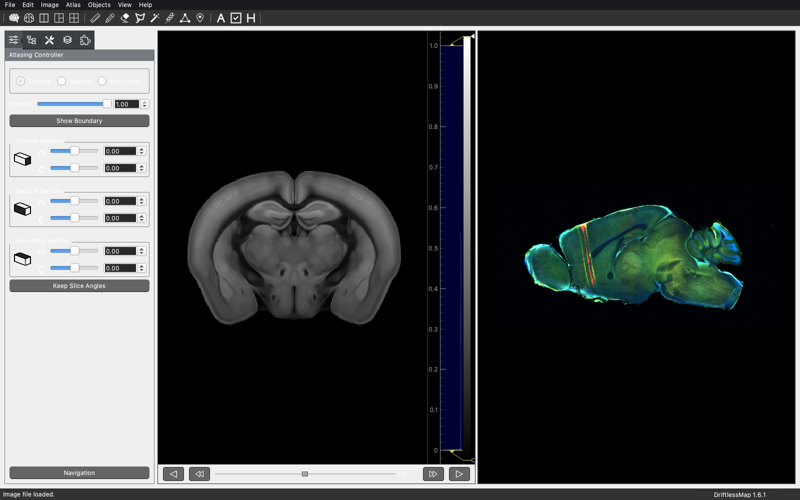
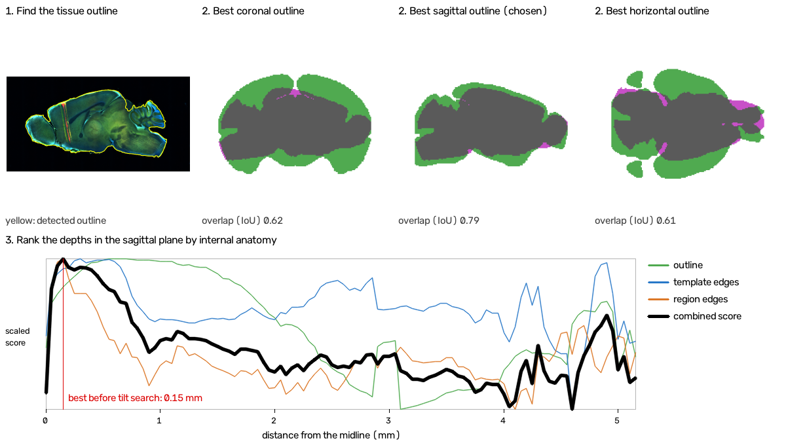
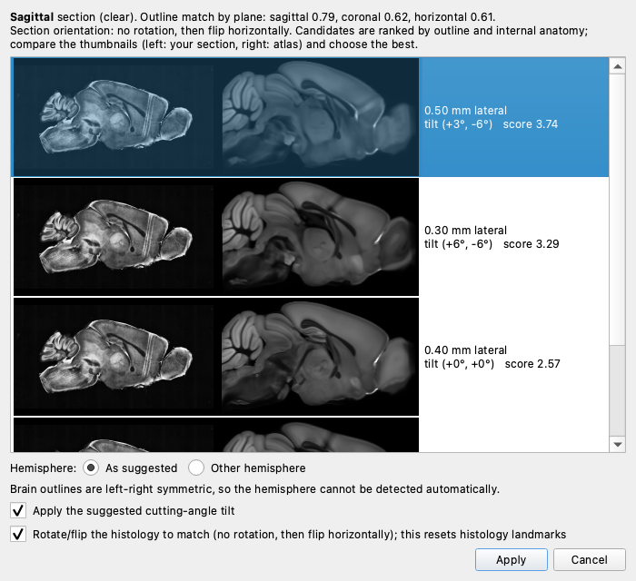
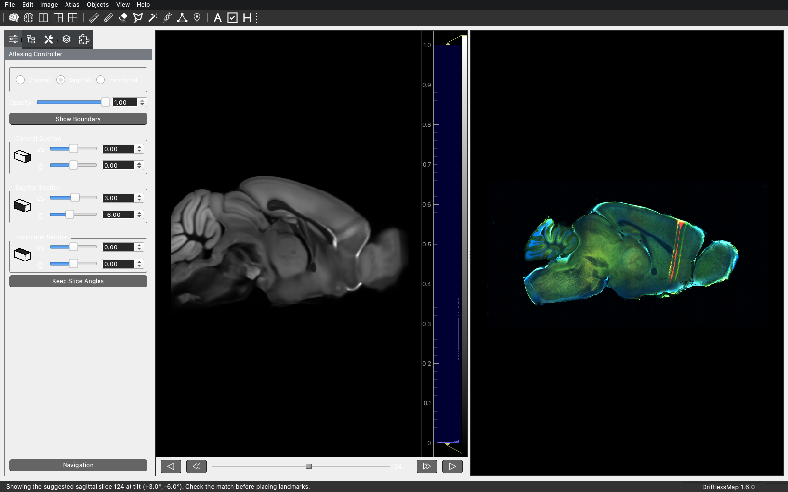
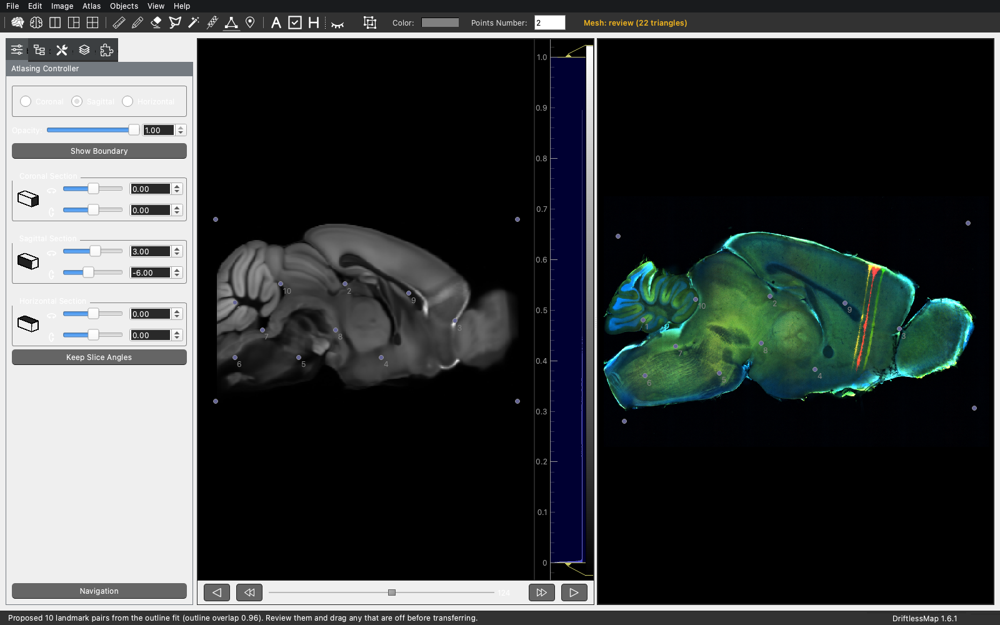
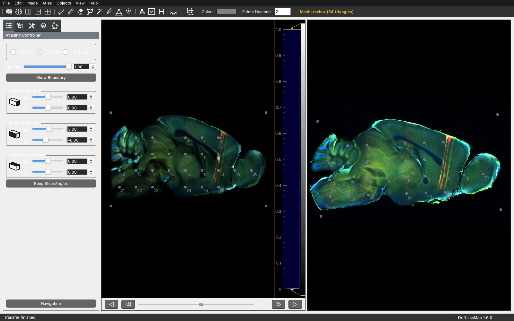
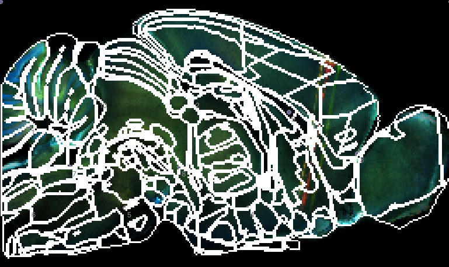

## Automatic Section Matching and Landmark Proposal

DriftlessMap can suggest a starting point for registering a histological
section to a volume atlas. It does this in two steps:

- **Find atlas section** (Match step; classic interface: **Atlas > Suggest
  Atlas Section...**) finds the atlas depth, cutting angle and image
  orientation that best match the section, in the plane you name.
- **Suggest landmarks** (Register step; classic interface: **Atlas > Propose
  Landmarks**) fits the chosen atlas slice to the section and fills in the
  Triangulation tool with landmark pairs.

Both steps only suggest. You confirm the section, review the landmarks, and
nothing is transferred until you ask for it.

This tutorial uses a single sagittal mouse section with the Allen mouse atlas
at 50 µm. The User Manual has the reference description in
[Section 8.2](../../MANUAL.md#82-suggest-the-section-and-landmarks-automatically).
The screenshots were taken in the classic interface of DriftlessMap 1.6; the
2.0 interface has the same dialogs, reached from the Match and Register steps,
and the text below describes the 2.0 behaviour.

### Before you start

The automation works best on:

- one section per image, on a plain dark or light background;
- an image with a known pixel size (see below);
- an image cropped to roughly the section, without labels or scale bars.

The section outline is found by thresholding, so debris, bubbles or a second
section in the image will change the outline that is compared. Sections
missing a part (for example the ventral brain) are handled when the pixel size
is known.

**Registration channels.** For a multichannel image, tick the channels to
register on in the Section step (for example DAPI only), so a bright tracer
channel does not change the outline or the match.

**Pixel size.** The section is compared with the atlas at its real size. CZI
files and most microscope TIFFs record their pixel size, which the Section step
shows ("Pixel size: 1.634 µm (from the file)"); the scale bar on the histology
view uses it too. If the file records none, press **Pixel size...** there (or
**Image > Pixel Size...**) and enter micrometres per pixel; otherwise Find atlas
section asks for it.

### 1. Load the atlas and the section

Load the processed volume atlas (**File > Load Atlas**) and the section
(**File > Load Image**). The section does not need to be rotated or flipped
first, and the atlas can show any plane.

Here the atlas is showing a coronal slice. The section is sagittal, with the
olfactory bulb on the left, while the atlas shows anterior on the right.

### 2. How the section is found

In the Match step, choose the **Section plane** the section was cut in and
press **Find atlas section** (classic interface: **Atlas > Suggest Atlas
Section...**, which asks for the plane). The comparison runs in the background
and takes up to about half a minute. It has three stages, shown below for the
sample section (the figure was made with the 1.6 method, which scaled outlines
to fill each slice; stages 2 and 3 now place the section at its real size).

**Stage 1: the orientation (and, if you are not sure, the plane), from the
outline.** DriftlessMap finds the tissue outline (yellow, top left). It scales
atlas slices to a common size and compares their outlines with the section's,
in all eight rotations and flips of the section. The score is the overlap of
the two outlines (intersection over union; 1.0 means identical). In the
panels, grey is where both outlines overlap, magenta is section only and green
is atlas only.

The search stays in the plane you named. Compared without size, a small slice
of one plane can resemble a whole section of another, so choose **Not sure**
only when you do not know the plane. Then all three are compared: on the
sample, sagittal wins clearly (0.79, against 0.62 for coronal and 0.61 for
horizontal), and the dialog calls the plane **clear** when the winner leads by
at least 0.08, **uncertain** at 0.03 to 0.08, and **ambiguous** below that.

**Stage 2: the depth, from internal anatomy.** Neighbouring slices have
nearly the same outline. In the plot, the outline score (green) is almost
flat over the first millimetre from the midline, so the outline alone cannot
pick the depth. For every slice in the chosen plane, DriftlessMap therefore
places the section, at its real size, inside the atlas slice. Tissue shrinks
and flattens when it is fixed and mounted, so the section may be enlarged by
0.9-1.5x and stretched in height by 0.8-1.3x. Each point of the section's
outline is charged its distance to the atlas outline, capped at 180 µm, so a
cut or torn edge inside the brain costs little; tissue outside the brain is
penalised. It then compares what is inside:

- the edges in the section against the edges in the atlas template (blue);
- the edges in the section against the atlas region boundaries (orange).

These three measures (outline fit, template edges, region boundaries) are
combined into one score (black). For a sagittal
section only one hemisphere is searched, because the other hemisphere mirrors
it. On the sample, the combined score peaks 0.15 mm from the midline.

**Stage 3: the cutting angle.** Sections are rarely cut exactly along an
atlas plane. The four best, well-separated depths are therefore re-scored at
tilts of −6°, −3°, 0°, +3° and +6° about both axes of the plane. On the
sample, the best match after this search is 0.50 mm lateral, tilted
(+3°, −6°). The small tilt improved the match enough to move the best depth.

### 3. Choose the section

The dialog lists up to six candidates, best first. Each row shows your section
on the left and the atlas on the right, together with the depth, the tilt, the
combined score, a **confidence** level and the tissue size relative to the atlas
(for example "tissue at 78 % of atlas size").

1. Compare the thumbnails and select the candidate that matches best. The
   scores rank candidates within this search; they are not probabilities.
   **Confidence** (high, medium or low; hover over a candidate for the
   reasons) says whether the best one can be trusted: it is the lowest of how
   well the internal anatomy agrees with the atlas, how narrowly the depth is
   determined, and, when the pixel size was unknown, at most medium. On low
   confidence, check carefully or place the section by hand. The thresholds
   were set on sections cut from the atlas and are not yet checked on real
   sections with known positions.
2. **Side**: brain outlines are left-right symmetric, so the side cannot be
   detected. For sagittal sections choose the **Right** or **Left
   hemisphere**; for coronal and horizontal sections say where the animal's
   right side is in your section. The depth, tilt and orientation are mirrored
   to match.
3. **Apply the suggested cutting-angle tilt**: leave this on to use the tilt,
   or turn it off to show the untilted slice.
4. **Rotate/flip the histology to match**: leave this on to orient the image
   to the atlas. Here the section only needs a horizontal flip. Rotating or
   flipping the histology resets its landmarks.
5. Press **Apply**.

DriftlessMap switches to the sagittal plane and shows the chosen slice. It
enters the tilt in the Sagittal Section controls and flips the histology. The
status bar confirms what was applied.

Compare the two views before going on. If the match is poor, run the
suggestion again and pick another candidate, or adjust the slice and tilt by
hand as usual.

### 4. Propose landmarks

With the matching atlas slice on screen, press **Suggest landmarks** in the
Register step (classic interface: **Atlas > Propose Landmarks**).
If there are landmarks already, DriftlessMap asks before replacing them.
Remove any transform overlay first.

The fit has two stages:

1. **Outline fit.** A first guess matches the centre and extent of the two
   outlines. It is then refined into an affine fit (scale, shear, rotation and
   shift) of the smoothed outlines.
2. **Deformable refinement.** A smooth B-spline warp is fitted on the image
   intensities using mutual information. Mutual information tolerates the
   different contrast of a stained section and the atlas template. The warp
   is fitted three times, to the section sampled on slightly different
   grids, and keeps only the movement on which the three fits agree, so a
   slightly different image does not move the landmarks far. It is kept only
   if it improves the intensity match without making the outline match
   noticeably worse; otherwise the outline fit is used.

DriftlessMap then suggests up to 10 landmarks of two kinds. Both are
features you can see and check in both images:

- **Outline points (up to 5):** the sharpest tips and notches of the brain
  outline, such as the notch between the olfactory bulb and the cortex. Each is
  placed on the atlas outline and moved onto the nearest point of the section
  outline. Places where the slice cuts the brain at the image edge are
  skipped, and so are places where the atlas labels extend past the visible
  template.
- **Internal points (the rest):** strong edges in the atlas template that the
  fitted section shows too, such as the corpus callosum and the ventricles.
  An edge seen in only one image scores nothing. Examples are an atlas
  region border in uniform-looking tissue, or a dye track in the section.
  Internal points are kept about a tenth of the section apart.

The fixed frame points around the mesh are carried through the same transform,
so they agree with the interior landmarks.

Choosing good points does not make the fit itself more accurate; the points
are samples of the fitted transform. Their purpose is that each one sits on
something you can judge and correct.

For the sample, the status bar reports 10 suggested pairs: 5 on the outline
and 5 on internal edges, from the outline fit with an outline overlap of 0.96.
Here the deformable refinement did not improve the match, so it was not used.

- Points 1 to 5 are on the outline: the notch between the olfactory bulb and
  the frontal cortex, the notch between the cortex and the cerebellum, two
  notches on the ventral surface, and the dorsal crest of the cortex.
- Points 6 to 10 are on internal edges, along the corpus callosum and the
  ventricles.
- Point 8 lies where the dye track crosses the corpus callosum. The track is
  a strong edge that exists only in the section, so check this point
  carefully.
- The cerebellum gets no point: its outline is cut by the image edge, and its
  folia do not line up after the outline fit.

The Triangulation tool is switched on, and its status shows **Mesh: review
(22 triangles)**: some triangles are narrow and worth a look (see Section 8.5
of the manual).

### 5. Review, correct and transfer

The landmarks are suggestions: confirm each numbered pair against the anatomy
and drag any point that is off. Ten landmarks give a coarse mesh, so add
points where the anatomy needs more detail, such as the cerebellum here, as
you would when placing landmarks by hand. Then transfer the
section to the atlas as usual.

Turn on **Show Boundary** in the Atlasing Controller to draw the atlas region
boundaries over the transferred section:

On the sample, the outline of the section follows the atlas outline closely,
and large structures such as the cortex, hippocampus and olfactory bulb fall
in about the right places. Fine boundaries, deep structures and the
cerebellar folia are only approximately aligned. Correct the landmarks there
before using the registration for quantitative work.

### When the suggestions go wrong

- **The plane is wrong.** Name the plane instead of **Not sure**; outlines
  compared without size confuse planes.
- **The depth is off.** Check the pixel size in the Section step first: a
  wrong or missing size makes partial sections hard to place. Try the other
  candidates in the dialog. Weak or uneven staining gives the internal-anatomy
  score less to work with; low confidence warns about this. Sections shrunk by
  more than about a third, or strongly distorted, may need placing by hand.
- **The tilt looks wrong.** Apply the suggestion without the tilt, then set
  the tilt by hand. Only tilts within ±6° are searched.
- **The section is placed in the wrong part of the slice.** Tissue outside
  the brain, debris or a second section changes the outline: crop the image
  (Section step, Crop to lasso) and try again.
- **The landmarks are badly placed.** This usually means the atlas slice
  does not match the section. Fix the slice first, then propose again.
- **Few or no landmarks are proposed.** Points that land off the tissue are
  dropped, and at least three are needed. Check that the section outline is
  clean and that the histology is oriented like the atlas.
