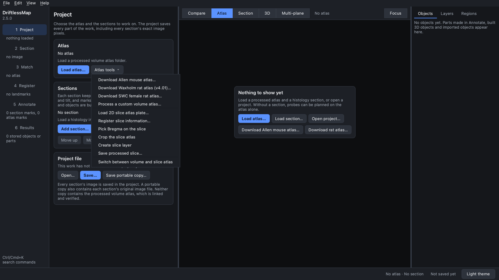
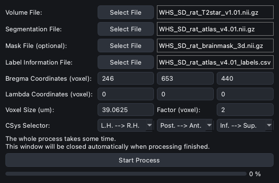
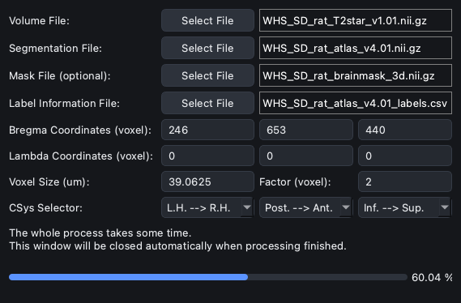
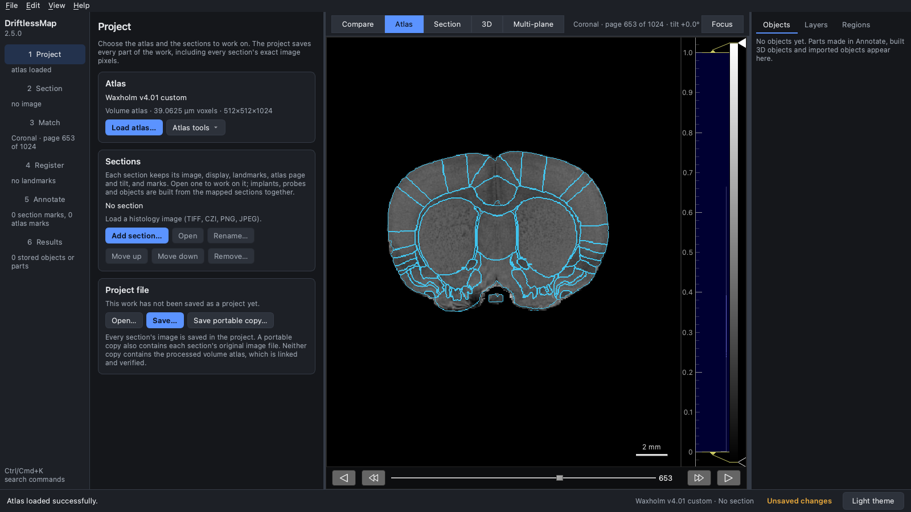

## Upload and process user defined atlases

Besides the atlases DriftlessMap downloads for you (Waxholm and SWC female rat,
Allen mouse), you can process any volume atlas of your own with the **Atlas
Processor**. You need four files, which atlas producers usually provide:

<table width="100%">
<tr>
<td align="center" width="40%">
volume atlas template file <br />
(volume file)
</td>
<td>
The template image, for example an MRI scan. NIfTI (<code>.nii</code>,
<code>.nii.gz</code>) or NRRD (<code>.nrrd</code>).
</td>
</tr>
<tr>
<td align="center">
segmentation/label file <br />
(label file)
</td>
<td>
Brain region segmentation of the same size. Each region is indicated by an
integer; 0 is background.
</td>
</tr>
<tr>
<td align="center">
mask file (optional)
</td>
<td>
A brain mask of the same size. Voxels where the mask is 0 are cleared in both
the template and the segmentation, so the skull is not displayed.
</td>
</tr>
<tr>
<td align="center">
label info file
</td>
<td>
The region names, label integers and hierarchy.
</td>
</tr>
</table>

This tutorial processes the Waxholm Space rat atlas v4.01 files from NITRC as
if they were your own atlas, so every step below is a real run:
`WHS_SD_rat_T2star_v1.01.nii.gz` (template),
`WHS_SD_rat_atlas_v4.01.nii.gz` (segmentation),
`WHS_SD_rat_brainmask_v1.01.nii.gz` (mask) and
`WHS_SD_rat_atlas_v4.01_labels.ilf` (label hierarchy). For the Waxholm atlas
itself you would normally use the built-in download instead
([Downloading the rat atlases](Atlas_Related/download_rat_atlases.md)).

The screenshots were taken in the 2.0 interface of DriftlessMap 2.5.0. The
reference description is in the
[User Manual, Section 6](../MANUAL.md#62-label-table).

### 1. Prepare the label information table

DriftlessMap reads the label information from a table in one uniform format:
a CSV file (`.csv`) or the first sheet of an Excel file (`.xlsx`). Column names
are not case sensitive. These columns are required:

| Column | Meaning |
| --- | --- |
| `id` | The integer stored in the segmentation file for this region. |
| `name` | Full region name. |
| `acronym` | Short region name. |
| `parent_id` | The `id` of the parent region; a negative value (such as -1) for a top-level region. `parent_structure_id`, as in Allen ontology exports, is accepted instead. |
| `structure_id_path` | The ids from the top of the hierarchy down to this region, such as `/1000/1001/1050/180/`. |

An optional `color_hex_triplet` column (`#RRGGBB`) gives each region its
colour; without it, regions get random colours.

Prefer CSV: reading `.xlsx` needs the `openpyxl` package, which DriftlessMap
does not install. Without it, processing stops with
``Atlas processing failed: `Import openpyxl` failed.``

The Waxholm atlas describes its hierarchy in an `.ilf` (XML) file, where each
region is a `<label>` element nested inside its parent with `id`, `name`,
`abbreviation` and `color` attributes. A short script turns it into the table:

```python
import csv
from xml.etree import ElementTree

root = ElementTree.parse("WHS_SD_rat_atlas_v4.01_labels.ilf").getroot().find("structure")
rows = []

def visit(element, parent, path):
    for label in element.findall("label"):
        region = int(label.get("id"))
        here = path + [region]
        rows.append([region, label.get("name", "").strip(),
                     label.get("abbreviation", "").strip(), parent,
                     "/" + "/".join(map(str, here)) + "/",
                     (label.get("color") or "#ffffff").upper()])
        visit(label, region, here)

visit(root, -1, [])
with open("WHS_SD_rat_atlas_v4.01_labels.csv", "w", newline="") as stream:
    writer = csv.writer(stream)
    writer.writerow(["id", "name", "acronym", "parent_id",
                     "structure_id_path", "color_hex_triplet"])
    writer.writerows(rows)
```

The result has 314 rows, one per region in the hierarchy, starting with:

| id | name | acronym | parent_id | structure_id_path | color_hex_triplet |
| --- | --- | --- | --- | --- | --- |
| 1000 | Brain | Brain | -1 | /1000/ | #32A852 |
| 1001 | White matter | wmt | 1000 | /1000/1001/ | #FFFFFF |
| 1050 | Olfactory white matter | olf | 1001 | /1000/1001/1050/ | #FFFFFF |
| 180 | lateral olfactory tract | lot | 1050 | /1000/1001/1050/180/ | #FF00DD |
| 67 | corpus callosum and associated subcortical white matter | cc-ec-cing-dwm | 1001 | /1000/1001/67/ | #FF6E00 |

### 2. Check the mask

The mask must be a 3D volume of exactly the template's size. A volume with one
extra fourth frame, as the Waxholm brain mask is stored
(512 × 1024 × 512 × 1), is accepted since DriftlessMap 2.5.1; earlier versions
refused it with *Atlas shape is different than mask shape*. (The run in this
tutorial used a 3D copy of the mask, made with nibabel as
`np.asanyarray(nib.load(path).dataobj)[..., 0]`.)

### 3. Open the Atlas Processor

In the **Project** step, open **Atlas tools** and choose **Process a custom
volume atlas…**. (In the classic interface: **Atlas > Atlas Processor**.)

<p align="center">

</p>

### 4. Fill in the files, Bregma, voxel size and axes

Use the four **Select File** buttons to choose the template, segmentation,
mask and label table. The processed atlas is written into the folder that
holds the volume file.

<p align="center">

</p>

- **Bregma Coordinates (voxel):** Bregma as three voxel coordinates of the
  volume file, in the file's own axis order and before any flips. A 0 means
  "not given" and is replaced by the middle of that axis. For Waxholm Space,
  Bregma is the voxel (246, 653, 440), the value the Waxholm download also
  uses.
- **Lambda Coordinates (voxel):** not used by the processor in 2.5.0; leave
  them at 0.
- **Voxel Size (um):** 39.0625 for Waxholm Space.
- **Factor (voxel):** mesh downsampling for the 3D view, an integer of at
  least 2. Larger values make coarser meshes and finish sooner; 2 is the
  default.
- **CSys Selector:** for each axis of the volume file (x, y, z, in file
  order), the direction in which its voxel index increases. Each anatomical
  axis (left-right, anterior-posterior, superior-inferior) must be used
  exactly once.

The axis directions are the most important information here. In Waxholm Space
the x axis goes from the left hemisphere to the right (**L.H. --> R.H.**), the
y axis from posterior to anterior (**Post. --> Ant.**) and the z axis from
inferior to superior (**Inf. --> Sup.**): RAS, which the NIfTI headers of these
files also report. That is already DriftlessMap's internal order, so the
processor stores the volumes unchanged. For an atlas in another order, the
processor flips and transposes the volumes, the segmentation and Bregma
accordingly (see [About atlas coordinates](Atlas_Related/about_atlas_through_herbs.md)).
Ask the atlas producer if you are not sure of the directions.

### 5. Process

Click **Start Process**. The button is hidden while the processor works, and
the bar shows its progress. The window closes by itself when processing has
finished.

<p align="center">

</p>

Processing these files took 35 minutes here, most of it spent making a 3D
mesh for each of the 222 regions present in the segmentation (the progress
passed 30% after 15 seconds and 60% after 14 minutes; times depend on the
computer). The run used the default factor of 2.

The folder now holds the processed atlas next to the source files:
`atlas_pre_made.pkl` (normalised template), `segment_pre_made.pkl`
(segmentation), `atlas_labels.pkl` (label information),
`sagital_contour_pre_made.pkl`, `coronal_contour_pre_made.pkl` and
`horizontal_contour_pre_made.pkl` (region outlines), `atlas_meshdata.pkl` and
`atlas_small_meshdata.pkl` with the `meshes` folder (3D meshes), and
`atlas_axis_info.pkl`, which records how the volume file's axes were turned
into DriftlessMap's (DriftlessMap uses it to convert points back to the
file's voxels, for example for
[external cell points](External_Related/upload_external_cell_points.md)).

### 6. Load the processed atlas

Processing does not load the atlas. Click **Load atlas…** in the **Project**
step and choose the folder. (The screenshot shows the region boundaries, which
**View > Show region boundaries** turns on.)

<p align="center">

</p>

The processed atlas opened at coronal page 653, the Bregma page, with
39.0625 µm voxels and all 314 regions of the table in the region tree. Its
template and segmentation volumes and its Bregma are identical to those of the
Waxholm atlas made by DriftlessMap's own download (compared array by array),
which is what the right axis directions and Bregma should give.

Check the result before you use it: browse all three planes, compare region
names with the atlas producer's, confirm that Bregma (coronal page 653 here)
is where it should be, and look at the 3D view.
